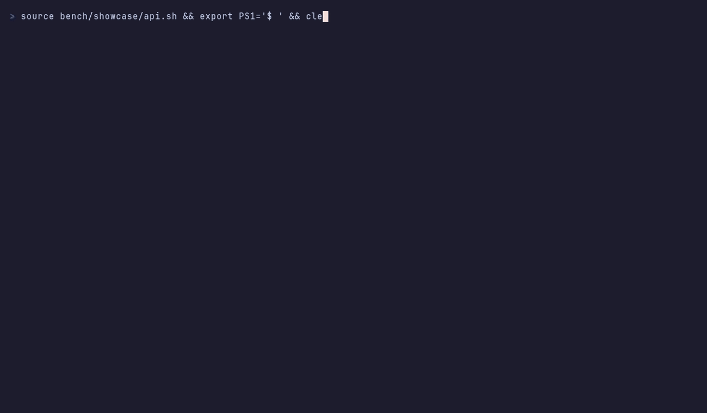
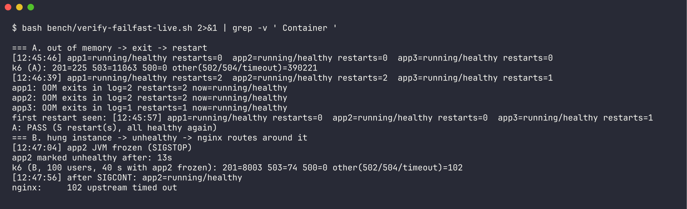
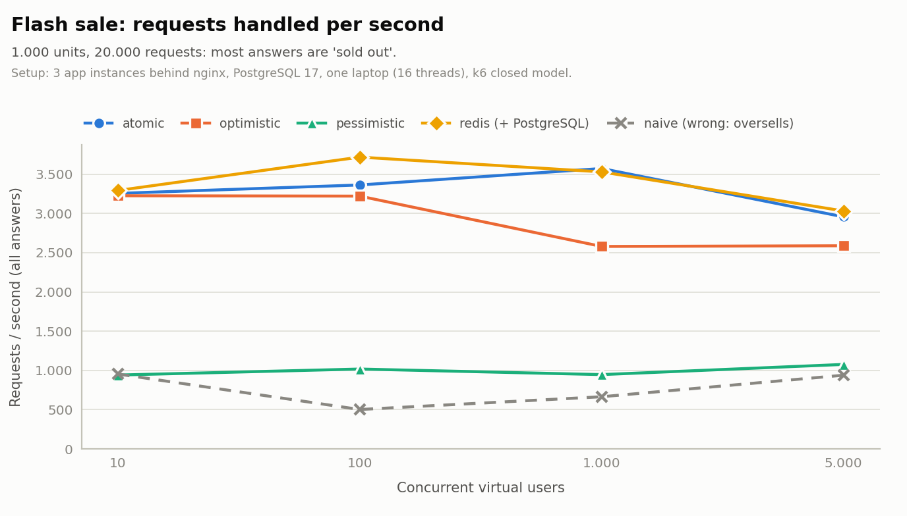
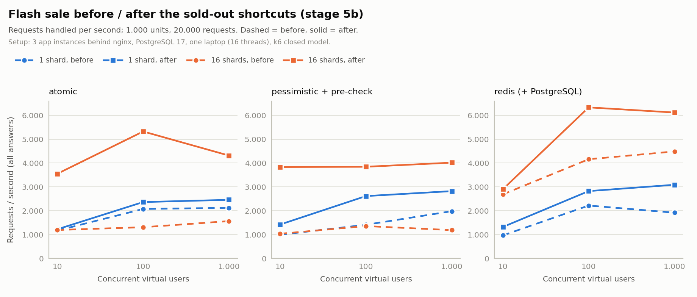

# Reservation Engine

Yüksek eşzamanlılık altında sınırlı stoğu satan (konser bileti, flaş indirim) ve
**overselling'i önleyen** çekirdek servis. Arayüz yok; odak doğruluk ve ölçülebilir performans.

> 🚧 Geliştirme aşamasında. Tam README (mimari, benchmark grafikleri, trade-off'lar) son aşamada eklenecek.

**Gerçek koşulardan görseller** (hepsi ve açıklamaları: [`docs/showcase/`](docs/showcase/README.md)):

| | |
|---|---|
| **API akışı:** `201` → aynı key ile `200` + `Idempotent-Replayed` → `409` tükendi → `200` onay → süresi dolmuş tutuma `410` | **Overselling:** 100 bilet için 1.000 eşzamanlı istek. `naive` 243 sattı, `atomic` tam 100 |
|  |  |
| **Fail fast:** OOM'da JVM çıkıyor ve yeniden başlıyor; donmuş instance 13 sn'de "unhealthy" oluyor, nginx onu trafikten çıkarıyor | **Mimari** |
|  |  |

## Hızlı başlangıç

Gereksinimler: Java 21, Docker (Compose v2).

```bash
docker compose up -d --wait      # PostgreSQL, Redis, Kafka
./mvnw spring-boot:run           # uygulama: http://localhost:8080
./mvnw verify                    # testler (Testcontainers ile gerçek PostgreSQL)
```

## API

```bash
# Etkinlik oluştur
curl -X POST localhost:8080/events -H 'Content-Type: application/json' \
     -d '{"name":"konser","stock":100}'

# Rezervasyon (aynı Idempotency-Key ile tekrar gönderilirse aynı sonuç döner)
curl -X POST localhost:8080/events/1/reserve -H 'Content-Type: application/json' \
     -H 'Idempotency-Key: 7f1c...' -d '{"userId":"alice"}'

# Stok durumu
curl localhost:8080/events/1/stock
```

| Durum | HTTP |
|---|---|
| Rezervasyon oluşturuldu | `201 Created` |
| Aynı istek tekrar geldi (replay) | `200 OK` + `Idempotent-Replayed: true` |
| Stok tükendi | `409 Conflict` (`urn:problem-type:sold-out`) |
| Aynı key'li başka bir istek şu an işleniyor | `409 Conflict` (`urn:problem-type:request-in-progress`) + `Retry-After` |
| Etkinlik yok | `404 Not Found` |
| Key başka bir etkinlik için kullanılmış | `422 Unprocessable Entity` |
| `Idempotency-Key` eksik / geçersiz gövde | `400 Bad Request` |
| Çekişme yüzünden vazgeçildi (optimistic, deneme hakkı bitti) | `503 Service Unavailable` + `Retry-After` |

Rezervasyon önce **`HELD`** olarak oluşur ve `expiresAt`'e kadar (varsayılan 10 dk, `HOLD_TTL`) ödeme bekler:

```bash
curl -X POST localhost:8080/reservations/{reservationId}/confirm   # ödeme callback'i
```

| Ödeme onayı | HTTP |
|---|---|
| Süre dolmadan onaylandı | `200 OK` (`CONFIRMED`) |
| Tekrarlanan callback | `200 OK` + `Idempotent-Replayed: true` |
| Süre dolduktan sonra geldi | `410 Gone` |
| Rezervasyon yok | `404 Not Found` |

## Stratejiler

`RESERVATION_STRATEGY` ortam değişkeniyle seçilir (varsayılan `atomic`):

| Ad | Yöntem |
|---|---|
| `naive` | Oku, kontrol et, yaz. **Bilerek hatalı**; overselling'i göstermek için var |
| `atomic` | `UPDATE ... SET qty = qty - 1 WHERE ... AND qty > 0`, tek ifade |
| `optimistic` | Version kolonu ile compare-and-set, sınırlı yeniden deneme |
| `pessimistic` | `SELECT ... FOR UPDATE`, sonra yazma |
| `pessimistic-precheck` | Önce kilitsiz `SELECT`; stok 0 ise kilitlemeden "tükendi", değilse `FOR UPDATE` ile doğrulama |
| `redis` | Redis'te Lua script ile atomik kapı, ardından PostgreSQL'de atomik UPDATE. Kaynak doğruluk PostgreSQL |

## Benchmark

Tek komut: `bench/run-all.sh` (jar ve imajı build eder, 40 koşuluk matrisi çalıştırır, grafikleri çizer).
Kurulum: nginx arkasında 3 uygulama instance'ı, PostgreSQL 17, Redis 7.4, yük üretici k6 (closed model).
Hepsi **tek bir laptopta** (16 thread, WSL2) çalışıyor; sayılar mutlak değil, stratejiler arası **göreli**
karşılaştırma için. Tam tablo: [`docs/benchmarks/summary.md`](docs/benchmarks/summary.md).

> ⚠️ **Ön sonuç.** Bu bölümdeki tüm sayılar **tek koşuya** dayanıyor. Final benchmark'ta (Aşama 8) ana
> konfigürasyonlar 3'er kez koşturulup ortalama ± standart sapma ile güncellenecek.

> **`redis` sonuçları "saf Redis" değil, "Redis + PostgreSQL"dir.** Redis yalnızca bir kapı; kapıdan geçen her
> istek PostgreSQL'de atomik UPDATE ve commit yapıyor, idempotency kontrolü de her istekte PostgreSQL'e gidiyor.

**1. Tek sıcak satıra yazma (stok hiç bitmiyor):**

<picture>
  <source media="(prefers-color-scheme: dark)" srcset="docs/benchmarks/contention-throughput-dark.png">
  
</picture>

- Throughput eşzamanlılıktan neredeyse bağımsız: **tek satır her şeyi sıraya sokuyor.** Satıra bir anda tek bir
  transaction yazabiliyor, her commit diske yazılmayı bekliyor. Tavan ~600 rezervasyon/sn.
- **`atomic` en hızlısı** (tek ifade, kilit sadece UPDATE'ten commit'e kadar). `pessimistic` kilidi
  rezervasyon INSERT'ü dahil transaction sonuna kadar tuttuğu için kritik bölge daha uzun. `optimistic` her
  isteğe ortalama ~1 retry ekliyor. `redis` burada fayda sağlamıyor (stok bitmediği için herkes kapıdan
  geçiyor), sadece fazladan bir Redis gidiş-dönüşü ekliyor.

**2. Flaş satış (1.000 stok, 20.000 istek; yanıtların %95'i "tükendi"):**

<picture>
  <source media="(prefers-color-scheme: dark)" srcset="docs/benchmarks/sellout-throughput-dark.png">
  
</picture>

- **`pessimistic` 2,7–3,8 kat yavaş:** "Tükendi" yanıtı vermek için bile `FOR UPDATE` ile satırı kilitliyor,
  yani reddetmeler de sıraya giriyor. `atomic`te koşulu sağlamayan UPDATE satırı kilitlemiyor; reddetmeler
  paralel.
- **`redis` ile `atomic` arasındaki fark −%1 ile +%11 arasında.** Redis UPDATE'i atlatıyor, ama her istek yine PostgreSQL'de 2–3
  sorgu yapıyor (idempotency kontrolü, etkinlik kontrolü, "tükendi" öncesi tekrar kontrol). Darboğaz satır
  kilidi değil, veritabanı gidiş-dönüşleri.

**3. Aşırı yük (5.000 eşzamanlı kullanıcı):**

<picture>
  <source media="(prefers-color-scheme: dark)" srcset="docs/benchmarks/contention-failures-dark.png">
  
</picture>

> **5.000 kullanıcı sütununu kapasite ölçümü olarak okumayın.** Bu seviyede tüm sonuçlar (throughput, p99,
> stratejiler arası sıralama) bağlantı havuzu zaman aşımlarından etkileniyor. Gösterdikleri şey sistemin
> gerçek kapasitesi değil, **aşırı yükteki hata davranışı**. Stratejileri karşılaştırmak için 10–1.000
> kullanıcı sütunlarını kullanın.

- Kapasitenin çok üstünde yükte isteklerin **%52–66'sı başarısız oluyor (HTTP 500).** Nedeni, bağlantı
  havuzu bekleme süresinin (5 sn) dolması: ortalama bağlantı bekleme süresi 2,3–2,9 sn. Başarılı throughput da
  düşüyor, çünkü sonunda başarısız olacak istekler beklerken kaynak tüketiyor. Çözüm (yük atma / backpressure,
  500 yerine 503) Aşama 7'de.

**4. Optimistic locking:** 503 oranı tüm koşularda **%0**. Ortalama retry: çekişmede ~1,0–1,1, flaş satışta
~0,06. Maksimum retry: 2–3 (deneme hakkı 10). PostgreSQL'de koşullu UPDATE de satır kilidini beklediği için
kaybedenler "boşa dönmek" yerine sıraya giriyor. Ayrıntı: [`optimistic-retries.png`](docs/benchmarks/optimistic-retries.png).

**Naif strateji** tüm koşularda overselling yaptı: flaş satışta (100 VU) 1.000 stok için **20.000
rezervasyon**, yani isteklerin tamamı başarılı. Üstelik stok sayacı hâlâ 655 gösteriyordu (`oversold = 19.655`).
Hızlı ama yanlış.

**Ölçüm sınırlamaları:** Her hücre tek koşu (tekrar ve güven aralığı yok; kısa denemelerle tam koşu arasında
%40'a varan fark gözlendi). k6 ve uygulamalar aynı CPU'yu paylaşıyor. Disk WSL2 sanal diski
(fsync maliyeti gerçek sunucudan farklı).

## Stock sharding (Aşama 3)

Bir etkinliğin stoğu N satıra (shard) bölünebiliyor: `POST /events {"name":..., "stock":..., "shards": 16}`.
İstek rastgele bir shard'dan başlıyor, boşsa sıradakine geçiyor; **"tükendi" cevabı ancak bütün shard'lar
denendikten sonra veriliyor.** Sharding kilitleme stratejisinden bağımsız bir katman: her strateji sadece
"tek satırdan bir birim al" işini yapıyor, hangi satırın deneneceğine `StockShards` karar veriyor.
Komut: `bash bench/run-sharding.sh`. Tam tablo: [`docs/benchmarks/sharding/summary.md`](docs/benchmarks/sharding/summary.md).

> ⚠️ **Ön sonuç** (tek koşu). Gürültü ölçüsü: aynı konfigürasyon iki ayrı koşuda 480 ve 626 rezervasyon/sn verdi.

**1. Yazma throughput'u (stok bitmiyor): 16 shard ile 3–5 kat.**

<picture>
  <source media="(prefers-color-scheme: dark)" srcset="docs/benchmarks/sharding/sharding-contention-dark.png">
  
</picture>

| 1.000 kullanıcı | 1 shard | 16 shard | Kat |
|---|---:|---:|---:|
| atomic | 602 | 3.095 | 5,1× |
| optimistic | 474 | 2.342 | 4,9× |
| pessimistic | 520 | 2.239 | 4,3× |
| pessimistic + pre-check | 515 | 2.341 | 4,5× |

- Atomic'in p99'u 5,4 sn'den 1,3 sn'ye düşüyor.
- **Darboğazın sıcak satır olduğunun doğrudan kanıtı:** Tek shard'da aktif PostgreSQL oturumlarının
  %55–92'si bir satır kilidini (`Lock`) bekliyor (`pg_stat_activity`'den saniyede bir örneklendi).
  10 kullanıcı ve 16 shard'da bu oran %13–22'ye iniyor.
- 100 ve 1.000 kullanıcıda 16 shard'la bile kilit beklemesi %69–80'de kalıyor: veritabanına aynı anda 60
  bağlantı (3 × 20) ulaşabiliyor, satır başına ~4 oturum düşüyor. Daha fazla shard bu oranı düşürür.

**2. Flaş satış: sharding "tükendi" yanıtını pahalılaştırıyor.**

<picture>
  <source media="(prefers-color-scheme: dark)" srcset="docs/benchmarks/sharding/sharding-sellout-dark.png">
  
</picture>

- Stok bittikten sonra her "tükendi" yanıtı **bütün shard'ları tek tek denemek zorunda** (16 shard = 16
  UPDATE). Atomic'te 16 shard, 1 shard'a göre %22–47 daha yavaş. 4 shard'da fark gürültü sınırında.
- Bu, sharding'in temel trade-off'u: yazmayı hızlandırırken "yok" demeyi pahalılaştırıyor.
  **Aşama 5b'de çözüldü:** versiyonlu "tükendi" işaretiyle 16 shard'lı flaş satış +%176 ile +%307 hızlandı
  (aşağıda).

**3. Pessimistic + kilitsiz ön kontrol (pre-check):**

| Flaş satış, 1 shard (req/s) | pessimistic | pessimistic + pre-check | Kat |
|---|---:|---:|---:|
| 10 kullanıcı | 1.076 | 2.643 | 2,5× |
| 100 kullanıcı | 1.065 | 4.615 | 4,3× |
| 1.000 kullanıcı | 968 | 3.204 | 3,3× |

- Ön kontrol, pessimistic'in flaş satıştaki zayıflığını gideriyor: stok 0 ise satır kilidine hiç
  dokunmadan "tükendi" diyor. Böylece atomic ve optimistic ile aynı seviyeye geliyor.
- Bedeli: stok bitmediği sürece her istek bir sorgu fazla yapıyor. Yazma senaryosunda fark −%12 ile +%10
  arasında, yani gürültü sınırında.

**Bu aşamada bulunan iki hata:**
- **Deadlock (pessimistic + sharding):** İstekler shard'ları farklı sırayla gezip boş shard'ların kilidini
  tutarken birbirini bekliyordu. Boş shard'ın kilidi artık bir savepoint'e geri dönülerek hemen bırakılıyor.
  PostgreSQL'in `ROLLBACK TO SAVEPOINT` ile satır kilidini bıraktığı ayrı bir deneyle doğrulandı. Düzeltme
  kaldırılınca testlerde 174 deadlock çıkıyor.
- **Önbellek hatası:** Shard sayısı etkinlik ID'sine göre önbelleğe alınıyordu. Benchmark ID'leri yeniden
  kullanınca (`RESTART IDENTITY`) 16 shard'lı etkinlikler tek shard'lı sanıldı ve stok varken "tükendi"
  denildi. Önbellek kaldırıldı. Benchmark artık her koşudan sonra "satılmamış stok kaldı mı?" ve "bütün
  shard'lar kullanıldı mı?" diye kendini de kontrol ediyor.

## Geçici rezervasyon ve süre dolumu (Aşama 4)

```
HELD --(ödeme, süre dolmadan)--> CONFIRMED
HELD --(süre doldu, sweeper)----> EXPIRED   (birim, alındığı shard'a geri döner)
```

- **İki geçiş de koşullu:** `UPDATE ... WHERE status = 'HELD'`. Ödeme ile süre dolumu aynı anda olursa satır
  kilidi altında yalnızca biri kazanır; kaybeden 0 satır günceller.
- **Tek saat:** Son tarih de, karşılaştırmalar da PostgreSQL'in `now()`'ı ile yapılıyor; instance'ların JVM
  saatleri arasındaki kayma sonucu etkilemiyor.
- **Sweeper her instance'ta çalışıyor**, lider seçimi yok. Süresi dolan satırlar `FOR UPDATE SKIP LOCKED` ile
  alınıyor: instance'lar birbirini beklemiyor ve aynı satırı iki kez almıyor. EXPIRED işaretlemesi ile stok
  iadesi aynı transaction'da. Stok satırları sabit sırayla `(event_id, shard_no)` güncelleniyor; iki sweeper
  birbirini kilitleyemiyor.
- **Invariant:** `held + confirmed + kalan = toplam`.

**Kanıtlar:**
- Deterministik yarış testleri iki kazanma sırasını da sınıyor:
  - **Süre dolumu önce kilitler:** Ödeme, kilidi bekler ve sonunda 0 satır günceller.
  - **Ödeme önce kilitler:** Sweeper kilitli satırı beklemeden atlar.
- Stres testinde 300 ödeme rastgele zamanlarda son tarih etrafında geldi (151 kazandı, 149 geç kaldı). Her
  yanıt, son durumla birebir uyuştu.
- Mutasyon testleri: `SKIP LOCKED`'ı ya da durum koşullarını kaldırınca testler kırmızıya dönüyor. İki koruma
  birden kaldırılınca 3.000 rezervasyonun 250'si iki kez sona erdirildi.
- **Canlı, 3 süreçle** (`bash bench/verify-expiry-live.sh`): 3 container, hiç ödenmeyen 3.000 rezervasyon,
  3 sn TTL. Hepsi tam bir kez sona erdi (instance başına 1.054 / 607 / 1.339) ve her shard yeniden 750 birime
  döndü.

## Olaylar: transactional outbox ve Kafka (Aşama 5a)

Her durum değişikliği (`ReservationHeld`, `ReservationConfirmed`, `ReservationExpired`) bir Kafka olayı üretir.

**Problem (dual write).** Veritabanına ve Kafka'ya ayrı ayrı yazmak iki şekilde bozulur; ikisi de testle
gösteriliyor:
- **Commit edildi, Kafka'ya gönderilmeden çökme:** Olay sonsuza kadar kayboldu.
- **Kafka'ya gönderildi, sonra DB transaction'ı geri alındı:** Hiç olmamış bir değişiklik için "hayalet" olay.

**Çözüm: transactional outbox.** Olay, durum değişikliğiyle **aynı transaction'da** `outbox` tablosuna bir satır
olarak yazılıyor. İkisi birlikte commit ya da rollback oluyor. Her instance'ta çalışan bir **polling relay**
yayınlanmamış satırları alıp Kafka'ya gönderiyor ve broker onayından sonra yayınlandı olarak işaretliyor.

| Garanti | Nasıl |
|---|---|
| Olay kaybı yok | Olay DB'de; relay gönderemezse satır yayınlanmamış kalır ve tekrar denenir |
| Paralel relay'ler aynı satırı aynı anda yayınlamaz | `FOR UPDATE SKIP LOCKED` |
| Bir rezervasyonun olayları sırayla gider | Kafka key = rezervasyon ID'si (aynı partition) **ve** bir rezervasyonun bir olayı, ancak daha eski olayları yayınlandıktan sonra seçilebilir. Aksi halde iki relay olayları ters sırayla gönderebilir ve key yanlış sırayı korur. |
| Teslimat **at-least-once** (kabul edildi) | Gönderim ile "yayınlandı" işareti atomik olamaz; arada çökme olursa olay tekrar gönderilir |
| Etki **tam bir kez** | Consumer, mesaj ID'sini etkiyle aynı transaction'da `consumer_inbox`'a yazar; gördüğü mesajı atlar |

**Kanıtlar:**
- 3 paralel relay 500 olayı tam bir kez yayınladı (160 / 180 / 160).
- Kasıtlı tekrar gönderimde Kafka'da her mesaj 2 kez vardı, etki yine 1 kez uygulandı.
- Deterministik test: A relay'i bir rezervasyonun `Held` olayını gönderirken, B relay'i aynı rezervasyonun
  `Confirmed` olayına dokunmuyor.
- Mutasyonlar: sıra koruması, inbox ve Kafka key'i ayrı ayrı kaldırılınca testler kırmızıya dönüyor.
- **Canlı, 3 container ve gerçek Kafka** (`bash bench/verify-events-live.sh`): 3.000 olayın hepsi yayınlandı
  (relay başına 1.215 / 1.083 / 702). 3.000 bildirim oluştu (consumer başına 1.019 / 998 / 983). Sırası bozuk
  rezervasyon 0.

## Idempotency "işlemde" durumu ve "tükendi" kısayolları (Aşama 5b)

**Idempotency claim.** İstek, stoğa dokunmadan **önce** `(kullanıcı, Idempotency-Key)` çiftini `IN_PROGRESS`
olarak ayrı bir transaction'da commit ediyor. `COMPLETED` durumu, rezervasyonla aynı transaction'da yazılıyor.
Yan etkisi olmayan istekler (tükendi, 503, hata) key'i serbest bırakıyor. Aynı anda gelen ikiz istek, stok için
yarışmak yerine **`409` + `urn:problem-type:request-in-progress`** ve `Retry-After` alıyor. Tekrar denediğinde
asıl sonucu görüyor. Sahibi çöken bir claim, kira süresi (`IDEMPOTENCY_LEASE`, 30 sn) dolunca devralınabiliyor.
Bu, Aşama 1'deki açığı **bütün stratejiler için** kapattı: aynı key'li 100 eşzamanlı istekten "tükendi" alan sayısı
0 (önceden Redis'te 8'e kadar).

**"Tükendi" kısayolları** (stok satırına ve transaction'a dokunmadan cevap):
- **Redis:** Kapı sayacı 0 ise tek bir Redis `GET` yetiyor.
- **Versiyonlu "tükendi" işareti (DB stratejileri):** Bütün shard'ları boş bulan istek, etkinlik satırına
  "şu stok versiyonunda tükendi" yazıyor (compare-and-set). Sonraki istekler bunu tek bir PK okumasıyla görüyor.
- **Stok iadesinde temizleniyor:** Süresi dolan bir rezervasyon birim iade edince etkinliğin stok versiyonu artıyor
  (işaret kendiliğinden geçersizleşiyor) ve Redis sayacı artıyor (kısayol kapanıyor). İkisi de testli.
- **Kısayol bile idempotency'ye bakıyor:** Başarılı bir isteğin tekrarı "tükendi" değil, kendi sonucunu alıyor.

**Flaş satış, önce / sonra** (aynı makine, aynı oturumda arka arkaya ölçüldü; ⚠️ ön sonuç, tek koşu).
Tam tablo: [`docs/benchmarks/sellout-5b/summary.md`](docs/benchmarks/sellout-5b/summary.md).

<picture>
  <source media="(prefers-color-scheme: dark)" srcset="docs/benchmarks/sellout-5b/sellout-before-after-dark.png">
  
</picture>

| req/s (100 kullanıcı) | önce | sonra | değişim |
|---|---:|---:|---:|
| atomic, 1 shard | 2.074 | 2.364 | +%14 |
| atomic, 16 shard | 1.308 | 5.324 | **+%307** |
| pessimistic + pre-check, 16 shard | 1.356 | 3.844 | +%184 |
| redis, 1 shard | 2.217 | 2.823 | +%27 |
| redis, 16 shard | 4.161 | 6.336 | +%52 |

- **En büyük kazanç shard'lı etkinliklerde** (+%176 ile +%307): Aşama 3'te bulunan "her 'tükendi' için bütün
  shard'ları gez" maliyeti ortadan kalktı. 16 shard artık flaş satışta da 1 shard'dan hızlı.
- **Tek shard'da +%5 ile +%85:** "Tükendi" yolu eskiden 3 okuma + 1 UPDATE yapıyordu; şimdi 2 okuma (DB) ya da
  1 Redis + 1 okuma.
- Satılmamış stok hiçbir koşuda kalmadı; overselling yok.
- **Bedeli:** Başarılı her rezervasyon artık bir commit fazla yapıyor (claim). Bu ölçümde 20.000 istekten
  sadece 1.000'i başarılı olduğu için etkisi küçük. Yazma ağırlıklı senaryodaki etkisi final benchmark'ta (Aşama 8)
  ölçülecek.

## Dağıtık kilit, fencing token ve Redis–DB mutabakatı (Aşama 6)

**Neden kilit tek başına yetmez (Redlock eleştirisi).** Kira tabanlı bir kilidin sahibi ölmeden sadece
**duraklayabilir**: GC duraklaması, yavaş disk, ağ gecikmesi. Kira dolar, başka biri kilidi alır, eski sahip uyanır
ve hâlâ kilidin kendisinde olduğunu sanarak yazar. Kilit servisi bunu engelleyemez, çünkü eski sahip kilide hiç
sormadan devam ediyor. Martin Kleppmann'ın Redis'in çok düğümlü kilit algoritması Redlock'a yönelik eleştirisi tam
olarak bu:
1. Redlock, doğruluk için sınırlı saat kayması ve sınırlı süreç duraklaması varsayıyor; gerçek sistemler bu
   varsayımları ihlal eder.
2. Redlock **fencing token** üretmiyor, yani korunan kaynak eski sahibi tanıyamıyor.

Çözüm: kilidi her alışta kesin olarak artan bir token üretmek ve **korunan kaynağın** her yazmada bu token'ı
kontrol etmesi. Bu projede kilit sadece verimlilik için var (aynı işi iki instance yapmasın). **Doğruluk fencing'den
geliyor.** Bu yüzden Redlock değil, tek düğümlü `SET NX PX` + `INCR` yeterli.

Bu projede aynı problem iki kez çıktı ve iki farklı depolamada çözüldü:

| | **Idempotency claim (PostgreSQL)** | **Mutabakat kilidi (Redis)** |
|---|---|---|
| Kira | `idempotency_keys.locked_until` | `SET lock:... NX PX 10000` |
| Token kaynağı | Devralmada `fence_token = fence_token + 1` (aynı upsert ifadesinde) | Kilidi alınca `INCR fence:...` |
| Korunan yazma | Rezervasyon transaction'ının başı (`SELECT ... FOR UPDATE` + token), `COMPLETED`, key'i bırakma | Redis kapı sayacına yazma |
| Kontrol nerede | SQL `WHERE fence_token = :token` | Lua script: `GET fence == token` ise `SET` (atomik) |
| Eski sahip ne yapar | Transaction'ı stoğa dokunmadan geri alınır; yeni sahibin durumunu döner | Yazması reddedilir; sayaç değişmez |
| Kanıt | Unique constraint kaldırılınca fencing'siz 2 rezervasyon oluştu; 3 mutasyon yakalandı | Eski sahip sayacı 8'den 7'ye çekemedi; 3 mutasyon yakalandı |

**Mutabakat işi.** Redis kapı sayacı, Redis'te düşürülüp DB transaction'ı sonuçlanmadan süreç çökerse DB'den
düşük kalır: var olan birimler satılamaz. Bu iş her instance'ta zamanlanmış çalışıyor; kilit, her turda yalnızca
birinin çalışmasını sağlıyor. İş her sayacı DB'deki gerçek kalan stoğa eşitliyor; her yazma fencing'li.
- Canlı doğrulama (`bash bench/verify-reconciler-live.sh`): 3 container, saniyede bir tur. Redis'e 7 birimlik kayma
  enjekte edildi (90 → 83). 3 saniye içinde düzeltildi (token 14, tek düzeltme).

**Kilidi meşru olarak tutan turun canlı trafikle yarışı.** Fencing yalnızca eski sahibi durdurur. Kilidi meşru
olarak tutan tur da DB'yi `t_okuma` anında okuyup Redis'e `t_yazma` anında yazar. Arada diğer instance'lar
çalışmaya devam eder. Turun yazdığı değer bu aradaki Redis değişikliklerini siler:

| Yarışan işlem | Sıra | Sonuç | Yön |
|---|---|---|---|
| Rezervasyon (önce Redis −1, sonra DB commit) | Redis −1 yazmadan önce, DB commit okumadan sonra | Silinen −1 yüzünden Redis, DB'den **yüksek** | Güvenli: son sözü DB veriyor |
| Rollback telafisi (Redis −1, sonra +1) | −1 yazmadan önce, +1 yazmadan sonra | Redis **yüksek** | Güvenli |
| Stok iadesi (önce DB commit, sonra Redis +n) | DB commit okumadan sonra, Redis +n yazmadan önce | Silinen +n yüzünden Redis, DB'den **düşük** | **Zararlı:** var olan birimler reddediliyor; sayaç 0'a inerse "tükendi" kısayolu yanlış cevap veriyor |

- **Yüksek gösterme nasıl kapanıyor:** Fazla birim kadar istek kapıdan geçip DB'den "tükendi" alıyor; sayaç bu
  isteklerle düşüyor. Ya da bir sonraki tur sayacı indiriyor. Kimseye yanlış cevap verilmiyor; tek bedel fazladan
  DB işi.
- **Düşük gösterme nasıl kapanıyor:** Kendiliğinden kapanmıyor, çünkü sayacı artıran tek işlemler iade ve
  rollback. Bir sonraki tura kadar sürüyor (varsayılan 30 sn). O turda da bir iade yarışırsa yeniden oluşabiliyor.
- **Uygulanan çözüm (tek Lua koşulu ve bir sürüm anahtarı):**
  - Düşük gösterme ancak sayacı **indiren** bir yazmayla oluşabiliyor.
  - Her iade, atomik olarak `stock-returns:<id>` sürüm anahtarını artırıyor.
  - Tur bu sürümü DB'den **önce** okuyor.
  - Sayacı artıran yazmaya her zaman izin var, çünkü bu yazma düşük göstermeyi yalnızca azaltabilir.
  - Sayacı indiren yazma yalnızca sürüm değişmemişse yapılıyor. Sürüm değiştiyse yazma atlanıyor ve bir sonraki
    tur yeniden deniyor.
  - Aynı yarış lazy initialization'da da vardı (DB okunur, iade sayaç yokken commit eder, eski değer yazılır). Aynı
    sürüm kontrolüyle kapatıldı.
  - Rollback telafisi artık sayacı yalnızca varsa artırıyor. Redis yeniden başladıktan sonra düz `INCR`, sayacı `1`
    değeriyle yeniden yaratıyordu.
- **Neden mutlak değer yerine fark (delta) uygulanmadı:** Delta da yarışıyor. Redis'i DB'den önce okursak, araya
  giren ve DB'de commit edilen bir rezervasyon iki kez sayılıyor ve sayaç düşük kalıyor. Redis'i DB'den sonra
  okursak, aynı pencere iadeler için açılıyor. Sayacın kendisi üzerinde karşılaştır-ve-yaz (CAS) da işe yaramıyor:
  ABA problemi var (bir iade +1, bir rezervasyon −1 yapınca değer aynı kalıyor), ayrıca sıcak etkinlikte sürekli
  başarısız oluyor. Sadece iadelerin artırdığı bir sürüm ABA'sız ve sıcak yolda maliyetsiz.
- Kanıt: `RedisReconcilerTest`, deterministik:
  - Turun okuması ile yazması arasına bir iade sokuldu. Sayaç 1'de kaldı ve rezervasyon başarılı oldu. Koruma
    yokken sayaç 0'a iniyor.
  - Uçuştaki rezervasyon sayacı 1 fazla bıraktı. Bir sonraki tur farkı kapattı; turu beklemeden gelen istekler de
    farkı tüketti.
  - 6 mutasyonun hepsi yakalandı.

## Aşırı yük ve zehirli mesajlar (Aşama 7a)

**Aşırı yükte 500 yerine 503.**
- Havuzdan bağlantı alınamazsa (havuz dolu ya da DB yok) veya Redis'e ulaşılamazsa artık `503` dönüyor:
  `Retry-After: 1` başlığıyla, tipi `urn:problem-type:dependency-unavailable`.
- Havuz beklemesi 5 sn'den 500 ms'ye indi (`DB_CONNECTION_TIMEOUT_MS`).

**Yük atma (load shedding).**
- Instance başına en fazla `SHED_MAX_IN_FLIGHT` (varsayılan 100) rezervasyon isteği aynı anda işleniyor.
- Fazlası hiç iş yapılmadan, mikrosaniyeler içinde `503` alıyor (`urn:problem-type:overloaded`).
- Reddetme idempotency claim'inden önce oluyor; aynı key ile tekrar deneme normal işleniyor.
- `POST /reservations/{id}/confirm` hiç reddedilmiyor. Ödeme onayı gecikirse, ödenmiş bir rezervasyonun süresi
  dolabilir.

**Kafka dead-letter topic (`reservation-events.DLT`).**

| Hata türü | Davranış |
|---|---|
| Mesaj kaynaklı (bug, constraint ihlali) | 3 deneme (200 ms arayla), sonra DLT. Gerçek hata DLT başlıklarında. Partition devam ediyor. |
| Bozuk içerik (eksik başlık, bozuk UUID/sayı) | Tekrar denenmeden DLT. |
| Ortam kaynaklı (DB'ye ulaşılamıyor) | DLT'ye **gitmiyor**. Üstel bekleme ile (en fazla 5 sn) kesinti bitene kadar tekrar deneniyor. Mesajın suçu yok; DLT'ye atmak bütün topic'i DLT'ye taşırdı. |

- Takas: DLT'ye düşen mesaj, o rezervasyonun sıralamasını bozuyor (sonraki olaylar onsuz işleniyor).
  Alternatifi, partition'daki bütün rezervasyonların durması.
- Aşama 5a'daki senaryo testle yeniden üretildi (`DeadLetterTest`): tek mesajı reddeden bir CHECK constraint.
  Mesaj 3 kez denendi ve DLT'ye gitti; arkasındaki mesaj işlendi. 5a'daki gerçek NULL hatasının istisnası da
  poison olarak sınıflanıyor.
- Kesinti testi: havuzdaki bütün bağlantılar tutuldu. Mesaj 3'ten fazla denendi, DLT'ye gitmedi ve bağlantılar
  bırakılınca işlendi.
- Mutasyon kontrolü: 6 mutasyonun hepsi yakalandı.

**5.000 kullanıcı: yük atmasız / limit 100 / limit 20** (`bash bench/run-overload.sh`, tek koşu).
- **Ortak koşullar:** Üç varyant da aynı kodla ve aynı yeni nginx ayarlarıyla koşuldu.
- **İstemci:** `Retry-After`'a uyuyor: 503 alınca bekleyip aynı key ile tekrar deniyor, en fazla 10 deneme.
- **Tam tablolar:** [`docs/benchmarks/overload/comparison.md`](docs/benchmarks/overload/comparison.md).
- `naive` sonuçlara katılmadı: kayıp güncellemeler yüzünden stok sayıları anlamsız.

**Önce bir bozucu etken: nginx'in pasif sağlık kontrolü aşırı yükte sağlıklı instance'ları da çıkarıyor.**
- 5.000 kullanıcıda uygulamaların TCP kabul kuyrukları doluyor; nginx'in yeni bağlantıları 2 sn'de zaman aşımına
  uğruyor. nginx log'u: "upstream timed out ... while **connecting** to upstream".
- `max_fails=1` olduğu için tek bir bağlantı hatası, sağlıklı bir instance'ı 10 sn trafikten çıkarıyor. Üçü
  birden çıkınca her istek anında 502 alıyor; istemci 502'yi tekrar denemiyor.
- Etkilenen koşular: yük atmasızda 10'da 8, limit 20'de 10'da 4 (atomic ve optimistic), limit 100'de 10'da 0.
  Limit 20'de daha sık olmasının olası nedeni: daha çok istek reddediliyor ve her reddedilen istemci tam 1 sn
  sonra tekrar geliyor (`Retry-After: 1`, rastgele sapma yok). Eşzamanlı tekrar dalgaları bağlantı patlaması
  yaratıyor. Bu bir hipotez; ayrıca ölçülmedi.
- **Bu yüzden karşılaştırmada sadece 502/504 almayan koşular kullanıldı.** nginx ayarının düzeltilmesi açık iş
  (aşağıda sınırlamalarda).

Temiz koşularda aynı strateji, iki limit:

| | Limit 100 | Limit 20 |
|---|---|---|
| Contention, başarılı rezervasyon/sn (pessimistic / redis) | 220 / 199 | 221 / 239 |
| Contention, başarılı isteğin p99'u (tek deneme) | 2,2 / 2,6 sn | 1,1 / 1,0 sn |
| Contention, p99 (ilk denemeden 201'e, beklemeler dahil) | 11,3 / 10,8 sn | 9,4 / 9,5 sn |
| Contention, 10 denemede vazgeçen istemci (5.000'den) | 8.568 / 8.666 | 12.180 / 10.810 |
| Sellout, başarılı rezervasyon/sn (pessimistic / redis) | 106 / 122 | **72 / 67** |
| Sellout, satılmadan kalan stok | 0 / 0 | 0 / 0 |
| Sellout, vazgeçen istemci | 0 / 0 | 138 / 242 |
| Toplam 503 (contention, tekrar denemeler dahil) | 114.713 / 113.397 | 136.660 / 127.010 |
| Ölen ya da yeniden başlayan instance | 0 | 0 |

Yük atmasız varyantta da instance ölmedi; ilk koşudaki OOM, `Retry-After`'a uymayan istemcinin fırtınasıyla
olmuştu. Ama 10 koşunun 8'inde nginx instance'ları trafikten çıkardı ve contention'da başarılı rezervasyon
16–69/sn'de kaldı (limitli varyantlarda 196–239). Sonuç: yük atma olmadan aşırı yük, ölmeyen ama trafikten
çıkarılan instance'lara dönüşüyor.

**İlk turun kararı: varsayılan limit 100** (ikinci turda doğrulandı, aşağıda). Little yasası (L = X × W: uçuştaki
istek = throughput × gecikme) ile gerekçe:
- **Sıcak satırda throughput limitten bağımsız.** Darboğaz satır kilidi; X ≈ 200–240/sn iki limitte de aynı.
  - Limit 100 → 3 × 100 = 300 istek uçuşta → W ≈ 300 / 210 ≈ **1,4 sn** ortalama.
  - Limit 20 → 60 istek uçuşta → W ≈ 60 / 220 ≈ **0,27 sn** ortalama.
  - Ölçülen p99'lar (2,2–2,6 sn ve 1,0–1,1 sn) bununla uyumlu. Yani contention için limit 20 daha iyi: aynı
    throughput, yarı gecikme. Fazla limit sadece kuyruk ekliyor.
- **Sellout'ta isteklerin çoğu ucuz.** "Tükendi" kısayolu bir Redis `GET` ya da bir satır okuması. Bunların
  throughput'u saniyede binlerce; aynı W hedefi için L ≈ X × W, 20'nin çok üstünde.
  - Limit 20 bu ucuz istekleri de reddediyor: satış %32–45 yavaşladı (106 → 72, 122 → 67/sn) ve 138–242 istemci
    vazgeçti.
- **Tek bir sabit limit iki iş yükünü birden karşılayamıyor.** Projenin ana senaryosu flaş satış ve limit 100'de
  nginx bozucu etkisi hiç görülmedi; bu yüzden varsayılan 100 kaldı. Contention'da bedeli p99 2,2–2,6 sn
  (önceki ~13 sn'ye göre yine çok iyi).
- **Doğru çözüm (önerilen sonraki adım):** Limiti HTTP girişine değil, kıt kaynağın kullanıldığı yere koymak:
  "tükendi" kısayollarından sonraki DB transaction adımına. O zaman Little yasasına göre ≈ havuz boyutu (20)
  doğru değer olur ve ucuz cevaplar sınırlanmaz. Alternatifi, gecikmeye göre kendini ayarlayan limit (adaptive
  concurrency).

**İkinci tur: nginx düzeltildi, limit DB adımında denendi.**

*nginx: "yavaş" ile "ölü" ayrıldı.*
- **Ayarlar:** `max_fails=10` (1 idi), bağlantı zaman aşımı 10 sn (2 idi), Tomcat kabul kuyruğu 2048 (100 idi).
- **Canlı kanıt** (`bash bench/verify-failfast-live.sh`):
  - 5.000 kullanıcı, yük atma kapalı: hiçbir instance çıkarılmadı, 0 tane 502/504. Eski ayarla bu yük 10 koşunun
    8'inde 502 fırtınası üretiyordu.
  - `SIGSTOP` ile dondurulan instance yine 14 sn'de "unhealthy" oldu ve nginx onu çıkardı (log'da "upstream
    server temporarily disabled").
- **Benchmark:** İkinci turun 20 koşusunun hiçbirinde 502/504 yok.

*Retry-After jitter ve "thundering herd" hipotezi* (`bash bench/measure-retry-herd.sh`).
- **Hipotez desteklenmedi.** Reddedilen istemcilerin geri dönüşleri jitter'la ve jitter'sız aynı derecede
  düzensiz (değişim katsayısı 0,38 / 0,42). 1 sn'lik periyodiklik iki durumda da var (otokorelasyon +0,72 /
  +0,84); kaynağı senkron tekrarlar değil.
- **Jitter'ın ölçülen etkisi:** tekrar deneme sayısı yarıya iniyor (141k → 74k) ve tepeler düşüyor (en yüksek /
  ortalama 2,57 → 1,95). Bu yüzden 503'ler artık 1–3 sn arası rastgele `Retry-After` veriyor.

*Limit: HTTP girişinde 100 mü, DB adımında 20 mi?*
- **Fark:** `SHED_MODE=db` sadece claim + stok transaction'ını sınırlıyor; "tükendi" kısayolları sınırsız.
- **Koşullar:** İki varyantta istemci, nginx ve jitter aynı.
- `naive` hariç, 4 strateji:

| | HTTP girişinde 100 | DB adımında 20 |
|---|---|---|
| Contention, başarılı rezervasyon/sn | 218–237 | **169–191** (%18–23 düşük) |
| Contention, başarılı isteğin p99'u | 2,0–2,4 sn | 2,3–3,4 sn |
| Sellout, başarılı rezervasyon/sn | 102–114 | **87–98** (%11–16 düşük) |
| Sellout, başarılı isteğin p99'u | 1,5–1,9 sn | 1,2–1,7 sn |
| Sellout, satılmadan kalan stok | 0 | 0 |
| Toplam 503 (contention / sellout) | 58–60 bin / 14–17 bin | 55–58 bin / 14–18 bin |
| 10 denemede vazgeçen istemci (contention) | 3.010–3.250 | 2.874–3.231 |
| Ölen instance, 502/504 | 0, 0 | 0, 0 |

**Neden DB adımındaki limit beklendiği gibi çalışmadı (ölçüldü).** Pessimistic ve redis koşularında saniyede bir,
Hikari ve PostgreSQL'den örnek alındı:
- **DB süresinin dağılımı:** PostgreSQL'deki meşgul oturumların **%93–98'i rezervasyon transaction'ı**.
  "Tükendi" okuması %0–0,8, claim %0,6–4,9, arka plan işleri (sweeper; relay ve mutabakat benchmark'ta kapalı)
  %0. Yani başka işler DB süresini çalmıyor.
- **Bekleyenler:** Hikari'de bağlantı bekleyen thread sayısı ortalama **64–368, en yüksek 2.184**. DB adımında
  instance başına en fazla 20 izin var; bu yüzden bekleyen yüzlercesi neredeyse tamamen **sınırsız "tükendi"
  okumaları**. Her okuma kısa sürüyor ama aşırı yükte sınırlı adımla aynı bağlantı kuyruğunda bekliyor. Ortalama
  bağlantı bekleme 89–114 ms; sellout'ta havuz zaman aşımı 1.780–6.248 (HTTP limitinde 250–400).
- **Sonuç:** "Ucuz" yol aslında ucuz değil, çünkü darboğaz kaynağı, yani bağlantı havuzunu paylaşıyor. Limit
  havuzun bir kısmını sınırladı; kuyruk sınırsız kaldı.

**Nihai varsayılan: HTTP girişinde, limit 100 (`SHED_MODE=http`).** Little yasasıyla:
- **Doğru soru:** "Hangi işin limiti?" değil, "Hangi kaynağın kuyruğu?". Limit, doygun kaynağı kullanan *bütün*
  işleri kapsamalı.
- **Bu sistemde kaynak bağlantı havuzu,** ve her rezervasyon isteği ona en az bir kez uğruyor ("tükendi"
  okuması dahil). HTTP girişindeki limit bu kuyruğu sınırlıyor: instance başına en fazla 100 istek → havuz
  kuyruğu ≤ 80.
- **Değer:** Sıcak satırda X ≈ 230/sn ile L = 300 → W ≈ 1,3 sn ortalama (ölçülen p99 2,0–2,4 sn). İlk turdaki
  limit 20 bunu yarıya indiriyordu ama sellout'u %32–45 yavaşlatmıştı. 100, ana senaryo olan flaş satışın
  bedelini ödetmeden contention gecikmesini ~13 sn'den ~2 sn'ye indiriyor.
- **Limit 20'yi kullanılabilir yapacak değişiklik:** Ucuz yolun havuzu hiç kullanmaması. Örneğin "tükendi"
  işaretini Redis'te ya da bellekte tutmak, okumalar için ayrı küçük bir havuz açmak, ya da okumayı da limitin
  içine almak. Aşama 8'e not edildi.

Ölçüm notu: DB adımı varyantının 6 koşusu bellek limitleri ve havuz örneklemesi olmadan, son 4'ü onlarla koşuldu
(bir bellek kesintisinden sonra). Dört stratejide de fark aynı yönde ve benzer büyüklükte. Tablolar:
[`docs/benchmarks/overload/comparison-round2.md`](docs/benchmarks/overload/comparison-round2.md).

**Benchmark'ın bellek ayak izi** (`bash bench/measure-memory.sh`): Üç koşu, Windows'un belleği azaldığı için
durduruldu (16 GB makine, boştayken 3 GB boş).

| | Önce | Sonra |
|---|---|---|
| Windows'un gördüğü WSL (vmmem), koşu tepesi | 5,7 GB | **4,1 GB** |
| k6 (5.000 VU) | 1,36 GB | 1,13 GB |

Önlemler:
- **WSL sayfa önbelleği:** Her stratejiden önce boşaltılıyor; vmmem 3,0 → 1,2 GB, belleği hemen Windows'a geri
  veriyor.
- **k6:** `GOGC=50` ve 2 GB sınır.
- **Konteynerler:** Hepsinde bellek sınırı (uygulama 768 MB, PostgreSQL 1 GB, Redis 256 MB, nginx 384 MB, Kafka
  1,5 GB).

**Tarihsel referans: Aşama 6 hali ("önce") ve ilk koşu.** Bunlar kontrollü bir karşılaştırma değil.
- **"Önce" farklı koşullarda ölçüldü:**
  - Uygulama: 5 sn havuz beklemesi, 500 dönüyor, yük atma yok.
  - **nginx:** pasif sağlık kontrolü yok, 60 sn zaman aşımları.
  - İstemci: `Retry-After` beklemiyor; zaten 503 de almıyordu.
- **Farkın bir kısmı nginx değişikliğinden geliyor** ve bu ölçümden ayrıştırılamıyor. Örneğin yeni nginx
  aşırı yükte instance'ları trafikten çıkarabiliyor (yukarıda); eski nginx bunu hiç yapmıyordu.
- Tablo: [`comparison-first-run-no-retry.md`](docs/benchmarks/overload/comparison-first-run-no-retry.md).

| Varyant (eski nginx, istemci `Retry-After`'a uymuyor) | 500 oranı | Başarılı rezervasyon/sn (contention) | Başarılı p99 (contention) | Başarılı p99 (sellout) | Ölen instance |
|---|---|---|---|---|---|
| Önce (Aşama 6: 5 sn bekleme, 500) | %78–83 contention, %6–60 sellout | 117–149 | 12,7–14,9 sn | 4,5–14,3 sn | yok |
| Yük atmasız (500 ms bekleme, 503) | %0 | **0,9–2,3** | 8,1–16,5 sn | 10,7–12,1 sn | **her contention koşusunda 1 instance (OOM)** |
| Limit 100 | %0 | 55–70 | 6,2–7,7 sn | 1,9–2,6 sn | yok |

İlk koşudan çıkanlar:
- **500'ler tamamen kalktı.**
- **Bekleme süresini kısaltmak tek başına zararlı.**
  - Bekleme 5 sn'den 500 ms'ye inince başarısız istekler 10 kat hızlı geri dönüyor; istemci de aynı hızla yeniden
    deniyor.
  - Bu çalkantı 512 MB heap'i doldurdu. `OutOfMemoryError`, Tomcat'in Acceptor ve Poller thread'lerini de
    öldürdü: instance yaşıyor ama bir daha bağlantı kabul etmiyor.
  - Bu, her contention koşusunda bir instance'ta oldu. Benchmark sürücüsü artık yanıt vermeyen instance'ı satıra
    yazıp konteynerleri yeniden başlatıyor.
- **Yük atma instance'ları ayakta tutuyor ve başarılı isteklerin gecikmesini yarıya, sellout'ta 2–6 kata indiriyor.**
- **Ama contention'da başarılı throughput yarıya düştü (≈135 → ≈65/sn).** İki neden var:
  1. `Retry-After`'a uymayan istemciler saniyede ~10.000 reddetme üretiyor. nginx, 3 JVM ve k6 aynı makinede;
     bu yük kabul edilen isteklerin CPU'sunu yiyor.
  2. 100 limiti sıcak satır için fazla yüksek. Ortalama havuz beklemesi hâlâ ~380 ms. Little yasası: 300 istek
     uçuşta, ~60/sn throughput → ~5 sn gecikme (ölçülen p99 6–7 sn).
- **Sellout'ta stok satılmadan kaldı (1.000 biriminin 396–984'ü, shed'siz ve sonra).** 20.000 isteğin %97'si 503
  aldı ve bu ölçümdeki istemci 503'ten sonra vazgeçiyor. 503 "tükendi" değil, "sonra tekrar dene" demek; tekrar
  denemeyen istemciyle stok satılamaz. Bu yüzden yukarıdaki asıl ölçüm `Retry-After`'a uyan istemciyle yapıldı.

**"Healthy ama ölü" instance düzeltildi (fail fast, sürecin kendisi için de).**

| Önce | Şimdi |
|---|---|
| OOM sonrası JVM yaşamaya devam ediyordu; Tomcat'in Acceptor thread'i ölmüştü | `-XX:+ExitOnOutOfMemoryError`: süreç kapanıyor; `restart: unless-stopped` temiz bir instance başlatıyor |
| Healthcheck `/actuator/health` (DB dahil), 30 başarısızlık = 90 sn sonra "unhealthy" | `/actuator/health/liveness` (DB'siz: aşırı yüklü ama çalışan instance ölü sayılmıyor), 2 sn timeout, 3 başarısızlık |
| nginx `proxy_next_upstream off`: hiçbir hata sayılmıyordu, ölü instance trafik almaya devam ediyordu | Pasif sağlık kontrolü: `max_fails=1 fail_timeout=10s`, paylaşılan `zone`, `proxy_read_timeout 15s`. Ulaşmış bir POST yine hiç yeniden gönderilmiyor |

Canlı deneme (`bash bench/verify-failfast-live.sh`):
- **128 MB heap ve 3.000 kullanıcı:** üç instance da OOM ile kapandı ve yeniden başladı (5 yeniden başlatma),
  sonunda hepsi sağlıklı.
- **app2'nin JVM'i `SIGSTOP` ile donduruldu:** 13 sn'de "unhealthy" oldu. 100 istemcili 40 sn'lik koşuda 102
  zaman aşımı oldu (8.003 başarılıya karşı).

Bu 102 zaman aşımı pasif kontrolün bedeli: nginx bir instance'ın öldüğünü ancak bir istek zaman aşımına
uğrayınca anlıyor; o sürede her istemcinin bir isteği takılıyor. Aktif sağlık kontrolü (HAProxy, Envoy, nginx
Plus) bu bedeli düşürür. Docker "unhealthy" bir konteyneri kendiliğinden yeniden başlatmıyor; bu bir
orkestratörün işi (ör. Kubernetes liveness probe).

## Bilinen sınırlamalar

| Sınırlama | Etki | Çözüm planı |
|---|---|---|
| **Idempotency claim'i her başarılı rezervasyona bir commit ekliyor.** | Yazma ağırlıklı senaryoda throughput'a etkisi henüz ölçülmedi. | Aşama 8 (final benchmark). |
| **Zehirli mesaj partition'ı durdurabilir.** Consumer'da işlenemeyen bir mesaj yeniden denenirken aynı partition'daki sonraki mesajlar bekliyor (geliştirme sırasında bir NULL hatasıyla yaşandı). | Bir hata, bir partition'daki bütün olayları geciktirir. | **Aşama 7a'da çözüldü:** 3 deneme, sonra dead-letter topic. |
| **DLT'deki mesajları yeniden yayınlayan bir araç yok.** | Hata düzeltilince mesajlar elle yeniden yayınlanmalı (consumer idempotent olduğu için güvenli). | Kapsam dışı; `reservation.consumer.dead_lettered` sayacı ve ERROR log'u alarm için var. |
| **Yük atma limiti HTTP girişinde ve sabit (100).** DB adımında 20 denendi, daha kötü çıktı: "tükendi" okuması da bağlantı havuzunu kullandığı için havuz kuyruğu sınırsız kaldı (Aşama 7a, ikinci tur). | Contention'da p99 2,0–2,4 sn; limit 20 bunu yarıya indirebilirdi. | Aşama 8: "tükendi" işaretini havuz dışına almak (Redis/bellek) ya da okumalara ayrı havuz, sonra DB adımında ≈ havuz boyutu; ya da adaptive concurrency. |
| **nginx'in sağlık kontrolü pasif.** Donmuş bir instance ancak üzerindeki istekler zaman aşımına uğrayınca (15 sn) çıkarılıyor. | Bu pencerede her istemcinin bir isteği takılıyor (100 istemcide ~100 zaman aşımı). `max_fails=1` sorunu düzeltildi: aşırı yükte artık sağlıklı instance çıkarılmıyor. | Aktif sağlık kontrolü ve outlier detection (HAProxy/Envoy). |
| **Havuz zaman aşımında claim'in bırakılması da bağlantı alamayabilir.** | Aynı key ile tekrar deneme, claim'in kirası (30 sn) dolana kadar "işlemde" (409) alır. | Not edildi. |
| **Outbox tablosu büyüyor.** Yayınlanmış satırlar silinmiyor. | Disk kullanımı zamanla artar. | Saklama süresi dolanları silen bir temizlik işi (kapsam dışı, not edildi). |
| **Shard sayısı etkinlik oluşturulurken sabitleniyor.** | Yayındaki bir etkinliğin shard sayısı değiştirilemez (resharding yok). | Kapsam dışı. |
| **Redis düşüşü ile DB sonucu arasında çökme.** Redis'ten birim düşüldükten sonra, DB transaction'ı sonuçlanıp telafi (`INCR`) çalışmadan uygulama çökerse, düşülen birim Redis'e hiç iade edilmez. | Redis sayacı bir sonraki mutabakat turuna kadar (varsayılan 30 sn) DB'den düşük kalır: o birimler bu süre boyunca satılamaz. | **Aşama 6'da çözüldü:** fencing'li mutabakat işi. |
