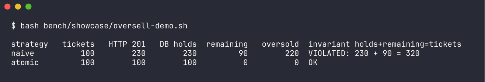
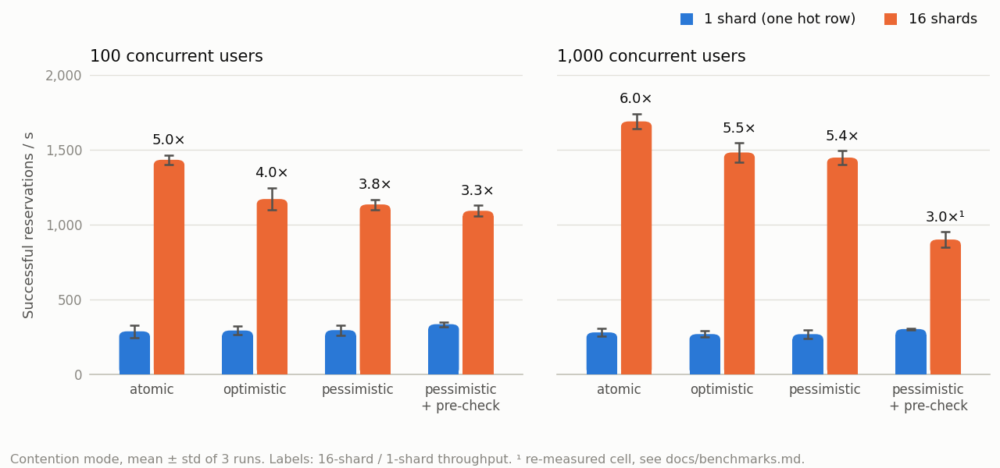
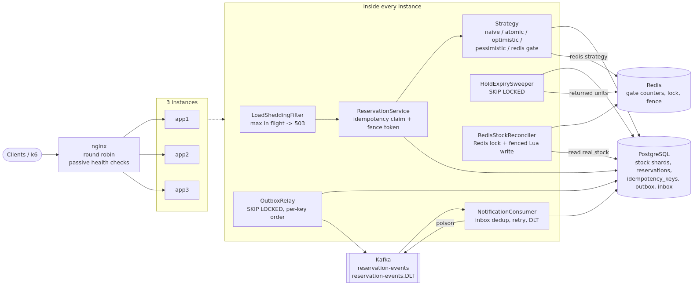

# Reservation Engine

[](https://github.com/samettns/reservation-engine/actions/workflows/ci.yml)


[](LICENSE)

A core service that sells limited stock under high concurrency (concert tickets, flash sales) **without
overselling**. No UI; the focus is correctness and measurable performance.

> Detailed docs (`docs/`) are in Turkish.

## Key finding

The bottleneck is not the locking strategy but the **hot row**: with one stock row, the five strategies are
within measurement noise of each other. The gains come from splitting the hot row (**sharding**: 3–6× write
throughput) and from answering "sold out" without touching it (**sold-out shortcuts**: 1.6–7.6× in a flash sale).
All numbers are the mean ± standard deviation of 3 runs ([final benchmark](docs/benchmarks.md#final-benchmark-aşama-8)).

## Highlights

| | |
|---|---|
| **Overselling** | **0** across the final benchmark's 49 run groups (×3 runs) and 149 tests; only the deliberately broken `naive` strategy oversells |
| **Sharding** | 16 shards: **3–6×** write throughput; 1.3–2.0× faster in a flash sale too |
| **Sold-out shortcuts** | **1.6–7.6×** in a flash sale |
| **Transaction order** | Hot stock UPDATE moved to the end of the transaction: **+28–65%** under contention (now the default) |
| **Tests** | **149 tests** against real PostgreSQL, Redis and Kafka (Testcontainers), checked with mutations |
| **Fault injection** | Redis down / hanging, slow DB, Kafka cut, instance dying during payment, OOM: the stock invariant holds in every scenario |

## Bugs found

- **Deadlock in pessimistic locking + sharding:** requests held locks on empty shards while waiting for each
  other; fixed by releasing them with `ROLLBACK TO SAVEPOINT` → [design.md](docs/design.md#stock-sharding-aşama-3)
- **Flaky lease test:** WSL's wall clock steps back ~500 ms every ~32 s; the test assumed it follows `sleep`, the
  code was right → [failure-testing.md](docs/failure-testing.md#testlerin-kendi-hataları)
- **Test-order dependence, found by the first GitHub CI run:** two tests relied on what ran before them;
  reproduced locally by forcing the order → [failure-testing.md](docs/failure-testing.md#testlerin-kendi-hataları)
- **Redis compensation bug, found when "stock UPDATE last" became the default:** a rolled-back sold-out
  transaction gave back a unit the DB never had, leaving Redis 1–7 above the DB
  → [benchmarks.md](docs/benchmarks.md#6-önce-insertler-stok-updatei-en-sonda-artık-varsayılan)

## Visuals

All from real runs; descriptions and more: [`docs/showcase/`](docs/showcase/README.md).

| | |
|---|---|
| **API flow:** `201` → same key `200` + `Idempotent-Replayed` → `409` sold out → `200` confirmed → `410` for an expired hold | **Overselling:** 1,000 concurrent requests for 100 tickets. `naive` sold 230, `atomic` exactly 100 |
|  |  |

**Sharding:** one hot row vs 16 shards, contention, mean ± std of 3 runs.

<picture>
  <source media="(prefers-color-scheme: dark)" srcset="docs/benchmarks/final/sharding-final-dark.png">
  
</picture>

**Architecture:** three instances behind nginx, PostgreSQL, Redis, Kafka.



## Features

- **Five locking strategies**, chosen by an environment variable; `naive` is deliberately broken to show
  overselling → [design.md](docs/design.md#stratejiler)
- **Stock sharding:** an event's stock split into N rows; empty shards are skipped without deadlocks
  → [design.md](docs/design.md#stock-sharding-aşama-3)
- **Temporary holds:** `HELD` → `CONFIRMED` / `EXPIRED`, a `SKIP LOCKED` sweeper on every instance
  → [design.md](docs/design.md#geçici-rezervasyon-ve-süre-dolumu-aşama-4)
- **Idempotency:** the key is claimed before stock is touched; a concurrent twin gets `409` "in progress";
  fencing tokens → [design.md](docs/design.md#idempotency-işlemde-durumu-ve-tükendi-kısayolları-aşama-5b)
- **Sold-out shortcuts:** a versioned DB marker and a Redis counter, cleared by stock returns
  → [design.md](docs/design.md#idempotency-işlemde-durumu-ve-tükendi-kısayolları-aşama-5b)
- **Redis gate and reconciliation:** a fenced Redis lock, the Redis–DB races analysed
  → [design.md](docs/design.md#dağıtık-kilit-fencing-token-ve-redisdb-mutabakatı-aşama-6)
- **Transactional outbox and Kafka:** no lost events, per-reservation order, exactly-once effect in the
  consumer, dead-letter topic → [events.md](docs/events.md)
- **503 + Retry-After under overload, load shedding, fail fast** (exit on OOM, route around a frozen
  instance) → [overload.md](docs/overload.md)
- **Fault injection** (Toxiproxy, container kills) and a circuit breaker for Redis
  → [failure-testing.md](docs/failure-testing.md)
- **Benchmarks:** k6, three instances behind nginx, 3 runs, correctness checked in every run
  → [benchmarks.md](docs/benchmarks.md)

**Stack:** Java 21 (virtual threads), Spring Boot 3.5, JdbcClient, PostgreSQL 17, Flyway, Redis 7.4,
Kafka (KRaft), nginx, Docker Compose, Testcontainers, Toxiproxy, k6, GitHub Actions.

## Quick start

Requirements: Java 21, Docker (Compose v2).

```bash
docker compose up -d --wait      # PostgreSQL, Redis, Kafka
./mvnw spring-boot:run           # app: http://localhost:8080
./mvnw verify                    # tests (Testcontainers: real PostgreSQL, Redis, Kafka)
```

```bash
curl -X POST localhost:8080/events -H 'Content-Type: application/json' -d '{"name":"concert","stock":100}'
curl -X POST localhost:8080/events/1/reserve -H 'Content-Type: application/json' \
     -H 'Idempotency-Key: 7f1c...' -d '{"userId":"alice"}'
```

All endpoints and status codes: [api.md](docs/api.md). Re-running the final benchmark:
`BATCH=1 bash bench/run-final.sh; BATCH=2 bash bench/run-final.sh` (details: [benchmarks.md](docs/benchmarks.md)).

## Documentation

| Document | Contents |
|---|---|
| [design.md](docs/design.md) | Strategies, sharding, temporary holds, idempotency, sold-out shortcuts, fencing and reconciliation |
| [api.md](docs/api.md) | Endpoints and HTTP status codes |
| [events.md](docs/events.md) | Transactional outbox, Kafka, dead-letter topic |
| [benchmarks.md](docs/benchmarks.md) | Final benchmark (3 runs) and the per-stage historical measurements |
| [overload.md](docs/overload.md) | 503, load shedding, choosing the limit, nginx, memory, fail fast |
| [failure-testing.md](docs/failure-testing.md) | Fault injection, Redis recovery, circuit breaker, bugs in the tests themselves |
| [limitations.md](docs/limitations.md) | Known limitations and future work |
| [showcase/](docs/showcase/README.md) | Visuals from real runs and their raw output |

## License

[MIT](LICENSE)
