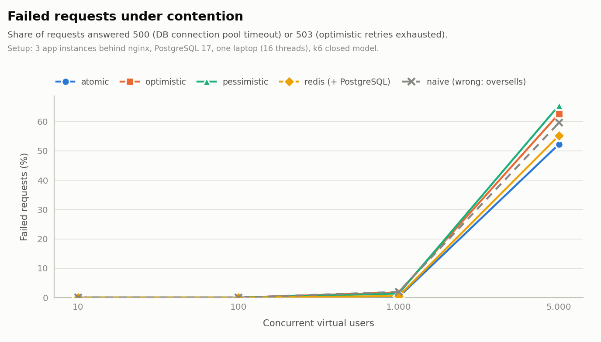

# Reservation Engine

Yüksek eşzamanlılık altında sınırlı stoğu satan (konser bileti, flaş indirim) ve
**overselling'i önleyen** çekirdek servis. Arayüz yok; odak doğruluk ve ölçülebilir performans.

> 🚧 Geliştirme aşamasında. Tam README (mimari, benchmark grafikleri, trade-off'lar) son aşamada eklenecek.

## Hızlı başlangıç

Gereksinimler: Java 21, Docker (Compose v2).

```bash
docker compose up -d --wait      # PostgreSQL, Redis, Kafka
./mvnw spring-boot:run           # uygulama: http://localhost:8080
./mvnw verify                    # testler (Testcontainers ile gerçek PostgreSQL)
```

## API

```bash
# Etkinlik oluştur
curl -X POST localhost:8080/events -H 'Content-Type: application/json' \
     -d '{"name":"konser","stock":100}'

# Rezervasyon (aynı Idempotency-Key ile tekrar gönderilirse aynı sonuç döner)
curl -X POST localhost:8080/events/1/reserve -H 'Content-Type: application/json' \
     -H 'Idempotency-Key: 7f1c...' -d '{"userId":"alice"}'

# Stok durumu
curl localhost:8080/events/1/stock
```

| Durum | HTTP |
|---|---|
| Rezervasyon oluşturuldu | `201 Created` |
| Aynı istek tekrar geldi (replay) | `200 OK` + `Idempotent-Replayed: true` |
| Stok tükendi | `409 Conflict` |
| Etkinlik yok | `404 Not Found` |
| Key başka bir etkinlik için kullanılmış | `422 Unprocessable Entity` |
| `Idempotency-Key` eksik / geçersiz gövde | `400 Bad Request` |
| Çekişme yüzünden vazgeçildi (optimistic, deneme hakkı bitti) | `503 Service Unavailable` + `Retry-After` |

## Stratejiler

`RESERVATION_STRATEGY` ortam değişkeniyle seçilir (varsayılan `atomic`):

| Ad | Yöntem |
|---|---|
| `naive` | Oku, kontrol et, yaz. **Bilerek hatalı**; overselling'i göstermek için var |
| `atomic` | `UPDATE ... SET qty = qty - 1 WHERE ... AND qty > 0`, tek ifade |
| `optimistic` | Version kolonu ile compare-and-set, sınırlı yeniden deneme |
| `pessimistic` | `SELECT ... FOR UPDATE`, sonra yazma |
| `redis` | Redis'te Lua script ile atomik kapı, ardından PostgreSQL'de atomik UPDATE. Kaynak doğruluk PostgreSQL |

## Benchmark

Tek komut: `bench/run-all.sh` (jar ve imajı build eder, 40 koşuluk matrisi çalıştırır, grafikleri çizer).
Kurulum: nginx arkasında 3 uygulama instance'ı, PostgreSQL 17, Redis 7.4, yük üretici k6 (closed model).
Hepsi **tek bir laptopta** (16 thread, WSL2) çalışıyor; sayılar mutlak değil, stratejiler arası **göreli**
karşılaştırma için. Tam tablo: [`docs/benchmarks/summary.md`](docs/benchmarks/summary.md).

> **`redis` sonuçları "saf Redis" değil, "Redis + PostgreSQL"dir.** Redis yalnızca bir kapı; kapıdan geçen her
> istek PostgreSQL'de atomik UPDATE ve commit yapıyor, idempotency kontrolü de her istekte PostgreSQL'e gidiyor.

**1. Tek sıcak satıra yazma (stok hiç bitmiyor):**

<picture>
  <source media="(prefers-color-scheme: dark)" srcset="docs/benchmarks/contention-throughput-dark.png">
  
</picture>

- Throughput eşzamanlılıktan neredeyse bağımsız: **tek satır her şeyi sıraya sokuyor.** Satıra bir anda tek bir
  transaction yazabiliyor, her commit diske yazılmayı bekliyor. Tavan ~600 rezervasyon/sn.
- **`atomic` en hızlısı** (tek ifade, kilit sadece UPDATE'ten commit'e kadar). `pessimistic` kilidi
  rezervasyon INSERT'ü dahil transaction sonuna kadar tuttuğu için kritik bölge daha uzun. `optimistic` her
  isteğe ortalama ~1 retry ekliyor. `redis` burada fayda sağlamıyor (stok bitmediği için herkes kapıdan
  geçiyor), sadece fazladan bir Redis gidiş-dönüşü ekliyor.

**2. Flaş satış (1.000 stok, 20.000 istek; yanıtların %95'i "tükendi"):**

<picture>
  <source media="(prefers-color-scheme: dark)" srcset="docs/benchmarks/sellout-throughput-dark.png">
  
</picture>

- **`pessimistic` 2,7–3,8 kat yavaş:** "Tükendi" yanıtı vermek için bile `FOR UPDATE` ile satırı kilitliyor,
  yani reddetmeler de sıraya giriyor. `atomic`te koşulu sağlamayan UPDATE satırı kilitlemiyor; reddetmeler
  paralel.
- **`redis` ile `atomic` arasındaki fark −%1 ile +%11 arasında.** Redis UPDATE'i atlatıyor, ama her istek yine PostgreSQL'de 2–3
  sorgu yapıyor (idempotency kontrolü, etkinlik kontrolü, "tükendi" öncesi tekrar kontrol). Darboğaz satır
  kilidi değil, veritabanı gidiş-dönüşleri.

**3. Aşırı yük (5.000 eşzamanlı kullanıcı):**

<picture>
  <source media="(prefers-color-scheme: dark)" srcset="docs/benchmarks/contention-failures-dark.png">
  
</picture>

- Kapasitenin çok üstünde yükte isteklerin **%52–66'sı başarısız oluyor (HTTP 500).** Nedeni, bağlantı
  havuzu bekleme süresinin (5 sn) dolması: ortalama bağlantı bekleme süresi 2,3–2,9 sn. Başarılı throughput da
  düşüyor, çünkü sonunda başarısız olacak istekler beklerken kaynak tüketiyor. Çözüm (yük atma / backpressure,
  500 yerine 503) Aşama 7'de.

**4. Optimistic locking:** 503 oranı tüm koşularda **%0**. Ortalama retry: çekişmede ~1,0–1,1, flaş satışta
~0,06. Maksimum retry: 2–3 (deneme hakkı 10). PostgreSQL'de koşullu UPDATE de satır kilidini beklediği için
kaybedenler "boşa dönmek" yerine sıraya giriyor. Ayrıntı: [`optimistic-retries.png`](docs/benchmarks/optimistic-retries.png).

**Naif strateji** tüm koşularda overselling yaptı: flaş satışta (100 VU) 1.000 stok için **20.000
rezervasyon**, yani isteklerin tamamı başarılı. Üstelik stok sayacı hâlâ 655 gösteriyordu (`oversold = 19.655`).
Hızlı ama yanlış.

**Ölçüm sınırlamaları:** Her hücre tek koşu (tekrar ve güven aralığı yok; kısa denemelerle tam koşu arasında
%40'a varan fark gözlendi). k6 ve uygulamalar aynı CPU'yu paylaşıyor. Disk WSL2 sanal diski
(fsync maliyeti gerçek sunucudan farklı).

## Bilinen sınırlamalar

| Sınırlama | Etki | Çözüm planı |
|---|---|---|
| **Redis stratejisinde eşzamanlı idempotent tekrarlar.** Aynı `Idempotency-Key` ile gelen kopyalar, ilk istek henüz commit edilmemişken Redis sayacını geçici olarak 0 görüp `409` alabilir. | Stok doğru kalır (overselling yok), ama başarılı olmuş bir isteğin kopyasına "tükendi" denir. Ölçüm: stok 1'de 100 eşzamanlı kopyadan ~8'i. DB stratejileri etkilenmez. | Aşama 5: istek işlenirken idempotency kaydını "işlemde" olarak tutmak. |
| **Redis düşüşü ile DB sonucu arasında çökme.** Redis'ten birim düşüldükten sonra, DB transaction'ı sonuçlanıp telafi (`INCR`) çalışmadan uygulama çökerse, düşülen birim Redis'e hiç iade edilmez. | Redis sayacı DB'den düşük kalır: o birimler satılamaz (undersell). Overselling'e yol açmaz, çünkü son kararı DB veriyor. | Aşama 7: Redis sayacını DB'deki kalan stokla eşitleyen bir mutabakat (reconciliation) işi. |
