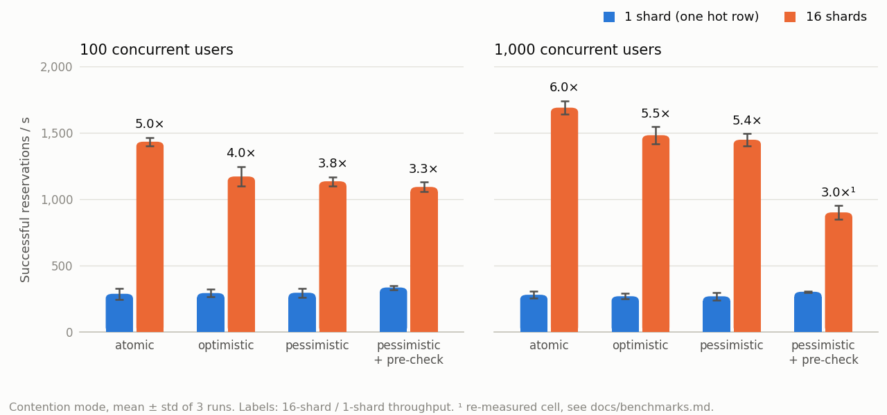
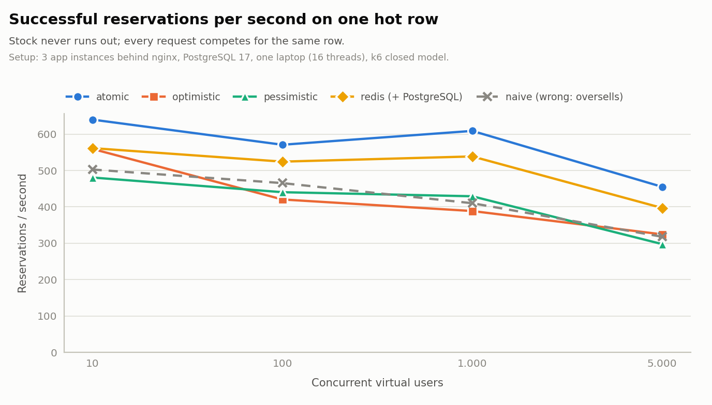
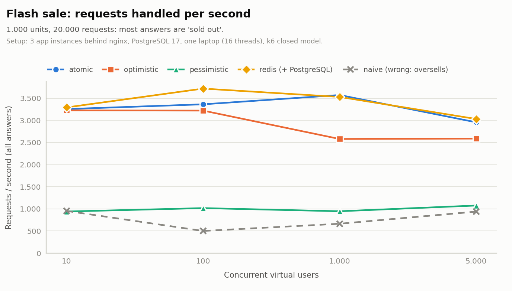
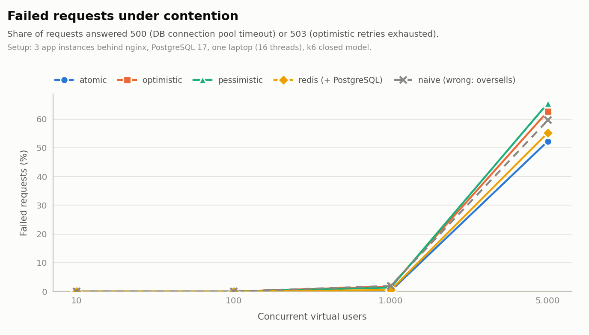
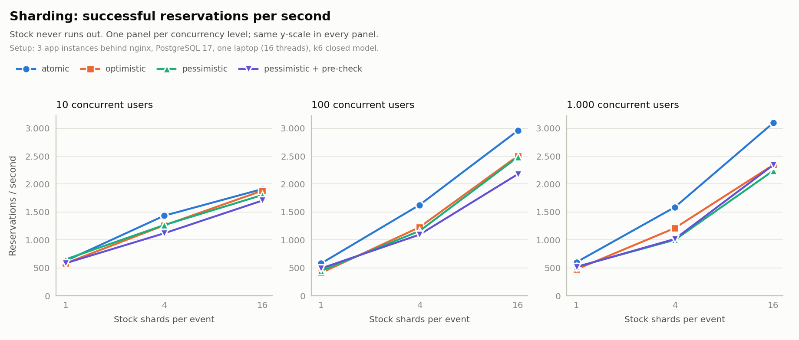
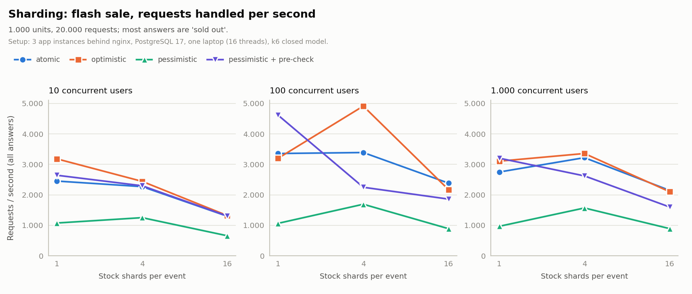
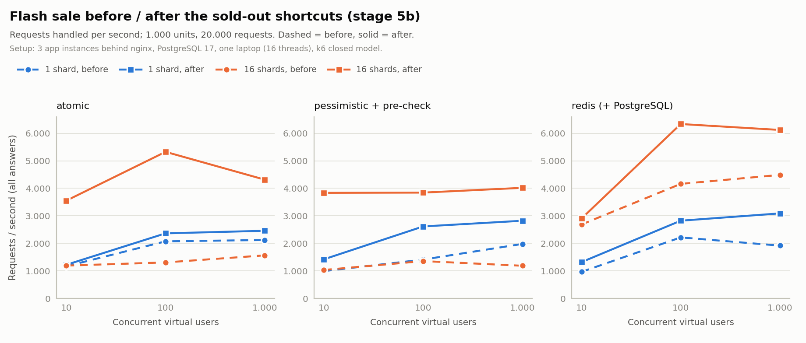

# Benchmark

Önce **final benchmark** (Aşama 8): bugünkü kod, 3 tekrar, ortalama ± standart sapma. Ana bulgu: darboğaz kilitleme stratejisi değil sıcak satır; kazanç sharding'den ve "tükendi" kısayollarından geliyor. Ardından aşamalar sırasında alınan **tarihsel** tek koşuluk ölçümler (o aşamanın koduyla); güncel sayılar için final benchmark esas alınmalı. Aşırı yük ölçümleri [overload.md](overload.md)'de.

## Final benchmark (Aşama 8)

Aşağıdaki tarihsel bölümlerdeki benchmark'lar o aşamanın kodu ve tek koşuydu. Bu bölüm **bugünkü kodu** ölçüyor.

- **Koşullar:** 3 tekrar, 100 ve 1.000 kullanıcı, ortalama ± standart sapma. İstemci `Retry-After`'a uyuyor; yük
  atma varsayılan ayarında (HTTP girişinde 100). Kafka olayları ve mutabakat, önceki benchmark'larda olduğu gibi
  kapalı.
- **Transaction sırası:** 1–5. maddeler eski sırayla (`TX_ORDER=stock-first`) ölçüldü. "Stok en sonda" sırası bu
  ölçümden sonra varsayılan oldu (6. madde); `bench/run-final.sh` eski sırayı açıkça seçiyor.
- **Aynı kod, tek ayar farkı:** Her karşılaştırmada sadece bir ortam değişkeni değişiyor (`BENCH_SHARDS`,
  `SOLDOUT_SHORTCUTS`, `TX_ORDER`, `REDIS_VERIFY_SOLD_OUT`).
- **Tekrarlar iç içe:** Önce her konfigürasyonun 1. tekrarı, sonra 2.'si... Makinenin zamanla yavaşlaması bir
  konfigürasyonu kayırmıyor.
- **Doğruluk:** 49 koşu grubunun hiçbirinde `naive` dışında fazla satış yok. k6'nın saydığı 201'ler her koşuda
  DB'deki rezervasyonlara eşit. Yeniden başlayan instance ve 500 yok.
- Komut: `BATCH=1 bash bench/run-final.sh; BATCH=2 bash bench/run-final.sh; python3 bench/summarize_final.py`.
  Tam tablo, her tekrarın değeriyle: [`docs/benchmarks/final/summary.md`](benchmarks/final/summary.md).

Aşağıdaki tablolarda değerler başarılı rezervasyon/sn.

### 1. 1 shard'da stratejiler arasında ölçülebilir fark yok

| | Contention, 100 | Contention, 1.000 | Flaş satış, 100 | Flaş satış, 1.000 |
|---|---:|---:|---:|---:|
| atomic | 288 ± 41 | 280 ± 26 | 187 ± 39 | 118 ± 8 |
| optimistic | 293 ± 30 | 269 ± 21 | 156 ± 16 | 114 ± 10 |
| pessimistic | 296 ± 33 | 269 ± 28 | 158 ± 23 | 113 ± 11 |
| pessimistic + pre-check | 335 ± 15 | 303 ± 3 | 175 ± 7 | 126 ± 11 |
| redis | 294 ± 55 | 292 ± 39 | 175 ± 11 | 130 ± 3 |

- Bütün farklar standart sapmaların içinde. **Aşama 2'deki "atomic en hızlısı" sonucu bugünkü kodla
  tekrarlanmadı.** O ölçüm tek koşuydu; tek koşu iki ayrı denemede %30'a varan fark verebiliyor.
- Pessimistic'in flaş satıştaki zayıflığı (Aşama 2'de 2,7–3,8 kat yavaş) kayboldu: versiyonlu "tükendi" işareti
  satır kilidinden önce cevap veriyor (4. madde).
- Tek shard'ın tavanı ~290/sn. Aşama 2'deki ~600'ün yarısı; arada her rezervasyona ayrı bir claim commit'i ve
  bir outbox satırı eklendi. Claim'in payı ayrıca ölçülmedi.

### 2. 16 shard: yazmada 3–6 kat, flaş satışta da hızlı

| | Contention, 100: 1 → 16 shard | Contention, 1.000: 1 → 16 | Flaş satış, 100: 1 → 16 | Flaş satış, 1.000: 1 → 16 |
|---|---:|---:|---:|---:|
| atomic | 288 → 1.433 (5,0×) | 280 → 1.689 (6,0×) | 187 → 287 (1,5×) | 118 → 176 (1,5×) |
| optimistic | 293 → 1.171 (4,0×) | 269 → 1.482 (5,5×) | 156 → 277 (1,8×) | 114 → 175 (1,5×) |
| pessimistic | 296 → 1.135 (3,8×) | 269 → 1.448 (5,4×) | 158 → 315 (2,0×) | 113 → 188 (1,7×) |
| pessimistic + pre-check | 335 → 1.092 (3,3×) | 303 → 901¹ | 175 → 290 (1,7×) | 126 → 167 (1,3×) |

<picture>
  <source media="(prefers-color-scheme: dark)" srcset="benchmarks/final/sharding-final-dark.png">
  
</picture>

Grafik: `python3 bench/plot_final_sharding.py` (aynı veri, hata çubukları ± std).

- Contention'da başarılı isteğin p99'u da düşüyor (atomic: 1,3 sn → 0,28 sn, 1,7 sn → 0,46 sn).
- **Aşama 3'teki "sharding 'tükendi'yi pahalılaştırıyor" sorunu artık yok:** Versiyonlu "tükendi" işareti
  sayesinde 16 shard flaş satışta da 1 shard'dan 1,3–2,0 kat hızlı.

¹ Yeniden koşulan 3 tekrar: 958 / 881 / 862 (901 ± 51). İlk 3 tekrar 393 / 1.337 / 1.403'tü. İlki aykırı değer:
2.303 Hikari zaman aşımı (diğerlerinde 49–60). Yeniden koşu ayrı bir oturumda yapıldı ve aynı oturumda
pessimistic ölçülmedi; bu hücreyi pessimistic ile karşılaştırmayın. Altı koşunun hepsinde throughput, Hikari
zaman aşımı sayısıyla ters yönde değişiyor (178–469 zaman aşımında 862–958/sn).

### 3. Pessimistic + pre-check: artık gerek yok

- Aşama 3'te ön kontrol, flaş satışta pessimistic'i 2,5–4,3 kat hızlandırıyordu. Bugün fark gürültü sınırında
  (175 ± 7 / 158 ± 23 ve 126 ± 11 / 113 ± 11). Contention'da da öyle (335 ± 15 / 296 ± 33).
- Neden: versiyonlu "tükendi" işareti, stok bittikten sonraki istekleri ön kontrolden de önce cevaplıyor.
  Ön kontrolün çözdüğü problemi artık işaret çözüyor.

### 4. "Tükendi" kısayollarının kazancı Redis'e özgü değil

Flaş satış, kısayollar kapalı → açık (`SOLDOUT_SHORTCUTS=false` / varsayılan):

| | 1 shard, 100 | 1 shard, 1.000 | 16 shard, 100 | 16 shard, 1.000 |
|---|---:|---:|---:|---:|
| atomic | 70 → 187 (2,7×) | 74 → 118 (1,6×) | 88 → 287 (3,3×) | 67 → 176 (2,6×) |
| pessimistic | 31 → 158 (5,2×) | 31 → 113 (3,7×) | 41 → 315 (7,6×) | 37 → 188 (5,1×) |
| redis | 62 → 175 (2,8×) | 68 → 130 (1,9×) | 80 → 146 (1,8×) | 64 → 130 (2,0×) |

- **Kazanç DB tarafındaki versiyonlu "tükendi" işaretinden geliyor.** Kısayollar açıkken `redis` 1 shard'da
  `atomic` ile aynı seviyede (175 / 187, 130 / 118), 16 shard'da ise geride (146 / 287, 130 / 176). Redis'in kendi
  kısayolu (sayaç 0 ise tek `GET`), bütün DB stratejilerinin kullandığı işaretin üstüne ölçülebilir bir şey
  eklemiyor. 16 shard'da `redis`'in neden geride kaldığı ölçülmedi.
- **Neden bu kadar büyük:** Kısayol kapalıyken her "tükendi" isteği üç transaction açıyor: claim'i commit et,
  stoğu dene (16 shard'da 16 satır), claim'i bırak. Açıkken claim'den önce tek bir PK okuması yetiyor.
  Pessimistic en çok kazanıyor, çünkü kısayolsuz her "tükendi" için `FOR UPDATE` alıyor.
- **Aşama 5b'deki önce / sonra ile karşılaştırılamaz** (+%14 ile +%307): oradaki "önce"de claim yoktu, "tükendi"
  isteği tek transaction'dı.

### 5. Redis kapısında "tükendi" doğrulaması: her zaman / sadece bayatken

**Varsayılan "her zaman" kalıyor.** `REDIS_VERIFY_SOLD_OUT=stale-only`, çok shard'lı kurulumda bir opsiyon;
**Redis kesintisi ve bayat veri senaryolarında doğrulanmadı.**

| Flaş satış, `redis` | her zaman (varsayılan), tekrarlar | sadece bayatken, tekrarlar | Fark |
|---|---|---|---|
| 16 shard, 100 | 148 / 143 / 147 | 300 / 310 / 547 | Medyanda ~2,1×, bir tekrarda 3,7× |
| 16 shard, 1.000 | 135 / 117 / 139 | 241 / 185 / 184 | Medyanda ~1,4× |
| 1 shard, 100 | 175 ± 11 | 133 / 114 / 107 (118 ± 13) | %33 **yavaş** |
| 1 shard, 1.000 | 130 ± 3 | 99 / 108 / 95 (101 ± 7) | %22 **yavaş** |

- **"Yanlış tükendi = 0" bir güvenlik kanıtı değil.** `stale-only` modunda kapının cevabı DB'ye hiç sorulmuyor;
  "DB'de stok vardı" sayacı bu modda yapısı gereği 0 kalıyor. Bu koşularda Redis kesintisi de yoktu.
- Varsayılan modda kesintisiz koşularda da kapının "tükendi" dediği 23–35 durumda DB'de birim bulundu. Bunlar
  büyük ihtimalle commit'i henüz bitmemiş uçuştaki rezervasyonların birimleri (doğrulanmadı).
- **Farkın nedeni açıklanamadı, iki yönde de.** Doğrulama, koşu başına sadece kapıya ulaşan 19–165 isteğe
  dokunuyor; ölçülen fark (−%33 ile +%110) bu kadar az isteğin maliyetiyle açıklanamıyor.
  - 1 shard için sınanan hipotez: "Tükendi" daha hızlı dönünce istemciler daha sık istek atar, tek satırda kilit
    çekişmesi artar. **Desteklenmedi:** `stale-only`'de istek/sn (2.365 / 3.498) ve kilit bekleme oranı
    (%43 / %68) daha *düşük*. Sadece LWLock beklemesi daha yüksek (%52 / %28).

### 6. "Önce INSERT'ler, stok UPDATE'i en sonda" (artık varsayılan)

Rezervasyon transaction'ında sıcak stok satırı en son güncelleniyor; satır kilidi sadece UPDATE'ten commit'e kadar
tutuluyor. **Aşama 8'in sonunda varsayılan oldu.** Eski sıra `TX_ORDER=stock-first` ile seçilebiliyor; başka bir
değer uygulamayı başlatmıyor (yazım hatası sessizce diğer sırayı seçmesin).

| 1 shard | Contention, 100 | Contention, 1.000 | Flaş satış, 100 | Flaş satış, 1.000 |
|---|---:|---:|---:|---:|
| atomic: stok önce → en sonda | 288 → 474 (+%65) | 280 → 441 (+%58) | 187 → 210 | 118 → 143 |
| pessimistic: stok önce → en sonda | 296 → 378 (+%28) | 269 → 350 (+%30) | 158 → 219 | 113 → 136 |

- **Contention'da büyük kazanç:** Atomic'te başarılı isteğin p99'u 1,3 sn'den 0,77 sn'ye düşüyor. Tekrarlar
  arası sapma da küçülüyor (±41 → ±8).
- **Beklenen bedel ölçülmedi:** Stok bittiğinde INSERT'ler boşa yapılıp geri alınıyor. Ama flaş satışta
  "tükendi" isteklerinin neredeyse hepsi kısayoldan cevap alıyor ve transaction'a hiç girmiyor. Flaş satış
  sonuçları stok önceki sıradan kötü değil.
- **Performans kazancı sadece `atomic` ve `pessimistic` için ölçüldü.** `optimistic`, `pessimistic-precheck` ve
  `redis` için ölçülmedi; bu stratejilerde sadece doğruluğu test edildi.
- **Doğruluk, her strateji için 1 ve 16 shard'da test edildi** (`StockLastTransactionTest`):
  - Eşzamanlılıkta tam stok kadar satış, rezervasyon başına tek olay, sonuçsuz kalan her key serbest.
  - Tükenince erken INSERT'ler geri alınıyor: rezervasyon, olay ve claim kalmıyor. Bir birim iade edilince aynı key
    ile istek başarılı oluyor ve birimin geldiği shard'ı kaydediyor.
  - Mutasyon kontrolü: geri almayı kaldırmak 28 testi, shard düzeltmesini kaldırmak 1 testi kırmızıya çeviriyor.
- **Varsayılanı değiştirmek bir hata buldu (`redis`):** Stock-last'te "tükendi" transaction'ı commit etmek
  yerine geri alınıyor. Redis kapısının geri alma telafisi (`INCR`), DB'de hiç birimi olmayan bir düşüşü de
  iade ediyordu: kapıdaki doğrulama, uçuştaki bir isteğin birimini aldığında sayaç DB'den bir yüksek kalıyordu
  (testte 1–7). Telafi artık sadece DB gerçekten bir birim verdiyse yapılıyor. Stock-first'te davranış aynı
  (orada bu transaction zaten commit ediyordu).

### Ölçüm notları

- **İlk tekrar etkisi:** Sadece `A-strategies`'in 1. tekrarı sistematik olarak düşük (medyanda %11; 16 hücrenin
  9'unda %15'ten fazla). Diğer konfigürasyonların 1. tekrarı 2. ve 3. ile aynı (medyan oran 0,98–1,05).
  - Her strateji instance'larını yeniden başlatıp 10 sn ısınıyor ve sonraki konfigürasyonlarda etki yok. Bu
    yüzden koşu başına ısınma süresi yetersiz değil.
  - `A-strategies`'in 1. tekrarı, bellek azlığı yüzünden yarıda kesilen bir oturumun ilk konfigürasyonuydu.
  - Tekrarlar iç içe olduğu için bu etki stratejileri eşit etkiliyor; karşılaştırmayı değil, mutlak değerleri
    biraz düşürüyor.
- Tek bir laptop (16 thread, WSL2): k6, nginx, 3 JVM, PostgreSQL ve Redis aynı CPU'yu paylaşıyor. Mutlak sayılar
  bu makineye özgü.

## Aşama 2: strateji karşılaştırması (tek koşu)

Tek komut: `bench/run-all.sh` (jar ve imajı build eder, 40 koşuluk matrisi çalıştırır, grafikleri çizer).
Kurulum: nginx arkasında 3 uygulama instance'ı, PostgreSQL 17, Redis 7.4, yük üretici k6 (closed model).
Hepsi **tek bir laptopta** (16 thread, WSL2) çalışıyor; sayılar mutlak değil, stratejiler arası **göreli**
karşılaştırma için. Tam tablo: [`docs/benchmarks/summary.md`](benchmarks/summary.md).

> ⚠️ **Tarihsel sonuç (Aşama 2 kodu, tek koşu).** Güncel ve 3 tekrarlı sonuçlar:
> [Final benchmark (Aşama 8)](#final-benchmark-aşama-8). Aradaki aşamalar her rezervasyona iş ekledi (ayrı claim
> commit'i, outbox satırı); bu bölümdeki mutlak sayılar bugünkü kodla karşılaştırılamaz.

> **`redis` sonuçları "saf Redis" değil, "Redis + PostgreSQL"dir.** Redis yalnızca bir kapı; kapıdan geçen her
> istek PostgreSQL'de atomik UPDATE ve commit yapıyor, idempotency kontrolü de her istekte PostgreSQL'e gidiyor.

**1. Tek sıcak satıra yazma (stok hiç bitmiyor):**

<picture>
  <source media="(prefers-color-scheme: dark)" srcset="benchmarks/contention-throughput-dark.png">
  
</picture>

- Throughput eşzamanlılıktan neredeyse bağımsız: **tek satır her şeyi sıraya sokuyor.** Satıra bir anda tek bir
  transaction yazabiliyor, her commit diske yazılmayı bekliyor. Tavan ~600 rezervasyon/sn.
- **`atomic` en hızlısı** (tek ifade, kilit sadece UPDATE'ten commit'e kadar). `pessimistic` kilidi
  rezervasyon INSERT'ü dahil transaction sonuna kadar tuttuğu için kritik bölge daha uzun. `optimistic` her
  isteğe ortalama ~1 retry ekliyor. `redis` burada fayda sağlamıyor (stok bitmediği için herkes kapıdan
  geçiyor), sadece fazladan bir Redis gidiş-dönüşü ekliyor.
- **Aşama 8'de tekrarlanmadı:** Bugünkü kodla, 3 tekrarda, 1 shard'da stratejiler arasındaki fark gürültüden
  ayırt edilemiyor ([final benchmark, 1](#1-1-shardda-stratejiler-arasında-ölçülebilir-fark-yok)).

**2. Flaş satış (1.000 stok, 20.000 istek; yanıtların %95'i "tükendi"):**

<picture>
  <source media="(prefers-color-scheme: dark)" srcset="benchmarks/sellout-throughput-dark.png">
  
</picture>

- **`pessimistic` 2,7–3,8 kat yavaş:** "Tükendi" yanıtı vermek için bile `FOR UPDATE` ile satırı kilitliyor,
  yani reddetmeler de sıraya giriyor. `atomic`te koşulu sağlamayan UPDATE satırı kilitlemiyor; reddetmeler
  paralel.
- **`redis` ile `atomic` arasındaki fark −%1 ile +%11 arasında.** Redis UPDATE'i atlatıyor, ama her istek yine PostgreSQL'de 2–3
  sorgu yapıyor (idempotency kontrolü, etkinlik kontrolü, "tükendi" öncesi tekrar kontrol). Darboğaz satır
  kilidi değil, veritabanı gidiş-dönüşleri.

**3. Aşırı yük (5.000 eşzamanlı kullanıcı):**

<picture>
  <source media="(prefers-color-scheme: dark)" srcset="benchmarks/contention-failures-dark.png">
  
</picture>

> **5.000 kullanıcı sütununu kapasite ölçümü olarak okumayın.** Bu seviyede tüm sonuçlar (throughput, p99,
> stratejiler arası sıralama) bağlantı havuzu zaman aşımlarından etkileniyor. Gösterdikleri şey sistemin
> gerçek kapasitesi değil, **aşırı yükteki hata davranışı**. Stratejileri karşılaştırmak için 10–1.000
> kullanıcı sütunlarını kullanın.

- Kapasitenin çok üstünde yükte isteklerin **%52–66'sı başarısız oluyor (HTTP 500).** Nedeni, bağlantı
  havuzu bekleme süresinin (5 sn) dolması: ortalama bağlantı bekleme süresi 2,3–2,9 sn. Başarılı throughput da
  düşüyor, çünkü sonunda başarısız olacak istekler beklerken kaynak tüketiyor. Çözüm (yük atma / backpressure,
  500 yerine 503) Aşama 7'de.

**4. Optimistic locking:** 503 oranı tüm koşularda **%0**. Ortalama retry: çekişmede ~1,0–1,1, flaş satışta
~0,06. Maksimum retry: 2–3 (deneme hakkı 10). PostgreSQL'de koşullu UPDATE de satır kilidini beklediği için
kaybedenler "boşa dönmek" yerine sıraya giriyor. Ayrıntı: [`optimistic-retries.png`](benchmarks/optimistic-retries.png).

**Naif strateji** tüm koşularda overselling yaptı: flaş satışta (100 VU) 1.000 stok için **20.000
rezervasyon**, yani isteklerin tamamı başarılı. Üstelik stok sayacı hâlâ 655 gösteriyordu (`oversold = 19.655`).
Hızlı ama yanlış.

**Ölçüm sınırlamaları:** Her hücre tek koşu (tekrar ve güven aralığı yok; kısa denemelerle tam koşu arasında
%40'a varan fark gözlendi). k6 ve uygulamalar aynı CPU'yu paylaşıyor. Disk WSL2 sanal diski
(fsync maliyeti gerçek sunucudan farklı).

## Aşama 3: sharding (tek koşu)

Sharding'in nasıl çalıştığı: [design.md](design.md#stock-sharding-aşama-3).

Komut: `bash bench/run-sharding.sh`. Tam tablo: [`docs/benchmarks/sharding/summary.md`](benchmarks/sharding/summary.md).

> ⚠️ **Tarihsel sonuç** (Aşama 3 kodu, tek koşu). Gürültü ölçüsü: aynı konfigürasyon iki ayrı koşuda 480 ve 626
> rezervasyon/sn verdi. Güncel, 3 tekrarlı sonuç: [final benchmark, 2](#2-16-shard-yazmada-36-kat-flaş-satışta-da-hızlı).

**1. Yazma throughput'u (stok bitmiyor): 16 shard ile 3–5 kat.**

<picture>
  <source media="(prefers-color-scheme: dark)" srcset="benchmarks/sharding/sharding-contention-dark.png">
  
</picture>

| 1.000 kullanıcı | 1 shard | 16 shard | Kat |
|---|---:|---:|---:|
| atomic | 602 | 3.095 | 5,1× |
| optimistic | 474 | 2.342 | 4,9× |
| pessimistic | 520 | 2.239 | 4,3× |
| pessimistic + pre-check | 515 | 2.341 | 4,5× |

- Atomic'in p99'u 5,4 sn'den 1,3 sn'ye düşüyor.
- **Darboğazın sıcak satır olduğunun doğrudan kanıtı:** Tek shard'da aktif PostgreSQL oturumlarının
  %55–92'si bir satır kilidini (`Lock`) bekliyor (`pg_stat_activity`'den saniyede bir örneklendi).
  10 kullanıcı ve 16 shard'da bu oran %13–22'ye iniyor.
- 100 ve 1.000 kullanıcıda 16 shard'la bile kilit beklemesi %69–80'de kalıyor: veritabanına aynı anda 60
  bağlantı (3 × 20) ulaşabiliyor, satır başına ~4 oturum düşüyor. Daha fazla shard bu oranı düşürür.

**2. Flaş satış: sharding "tükendi" yanıtını pahalılaştırıyor.**

<picture>
  <source media="(prefers-color-scheme: dark)" srcset="benchmarks/sharding/sharding-sellout-dark.png">
  
</picture>

- Stok bittikten sonra her "tükendi" yanıtı **bütün shard'ları tek tek denemek zorunda** (16 shard = 16
  UPDATE). Atomic'te 16 shard, 1 shard'a göre %22–47 daha yavaş. 4 shard'da fark gürültü sınırında.
- Bu, sharding'in temel trade-off'u: yazmayı hızlandırırken "yok" demeyi pahalılaştırıyor.
  **Aşama 5b'de çözüldü:** versiyonlu "tükendi" işaretiyle 16 shard'lı flaş satış +%176 ile +%307 hızlandı
  (aşağıda).

**3. Pessimistic + kilitsiz ön kontrol (pre-check):**

| Flaş satış, 1 shard (req/s) | pessimistic | pessimistic + pre-check | Kat |
|---|---:|---:|---:|
| 10 kullanıcı | 1.076 | 2.643 | 2,5× |
| 100 kullanıcı | 1.065 | 4.615 | 4,3× |
| 1.000 kullanıcı | 968 | 3.204 | 3,3× |

- Ön kontrol, pessimistic'in flaş satıştaki zayıflığını gideriyor: stok 0 ise satır kilidine hiç
  dokunmadan "tükendi" diyor. Böylece atomic ve optimistic ile aynı seviyeye geliyor.
- Bedeli: stok bitmediği sürece her istek bir sorgu fazla yapıyor. Yazma senaryosunda fark −%12 ile +%10
  arasında, yani gürültü sınırında.

## Aşama 5b: "tükendi" kısayolları, önce / sonra (tek koşu)

Kısayolların nasıl çalıştığı: [design.md](design.md#idempotency-işlemde-durumu-ve-tükendi-kısayolları-aşama-5b).

**Flaş satış, önce / sonra** (aynı makine, aynı oturumda arka arkaya ölçüldü; ⚠️ tarihsel sonuç, tek koşu;
"önce" Aşama 5a kodu, claim yok). Bugünkü kodla kısayollar açık / kapalı:
[final benchmark, 4](#4-tükendi-kısayollarının-kazancı-redise-özgü-değil).
Tam tablo: [`docs/benchmarks/sellout-5b/summary.md`](benchmarks/sellout-5b/summary.md).

<picture>
  <source media="(prefers-color-scheme: dark)" srcset="benchmarks/sellout-5b/sellout-before-after-dark.png">
  
</picture>

| req/s (100 kullanıcı) | önce | sonra | değişim |
|---|---:|---:|---:|
| atomic, 1 shard | 2.074 | 2.364 | +%14 |
| atomic, 16 shard | 1.308 | 5.324 | **+%307** |
| pessimistic + pre-check, 16 shard | 1.356 | 3.844 | +%184 |
| redis, 1 shard | 2.217 | 2.823 | +%27 |
| redis, 16 shard | 4.161 | 6.336 | +%52 |

- **En büyük kazanç shard'lı etkinliklerde** (+%176 ile +%307): Aşama 3'te bulunan "her 'tükendi' için bütün
  shard'ları gez" maliyeti ortadan kalktı. 16 shard artık flaş satışta da 1 shard'dan hızlı.
- **Tek shard'da +%5 ile +%85:** "Tükendi" yolu eskiden 3 okuma + 1 UPDATE yapıyordu; şimdi 2 okuma (DB) ya da
  1 Redis + 1 okuma.
- Satılmamış stok hiçbir koşuda kalmadı; overselling yok.
- **Bedeli:** Başarılı her rezervasyon artık bir commit fazla yapıyor (claim). Bu ölçümde 20.000 istekten
  sadece 1.000'i başarılı olduğu için etkisi küçük. Yazma ağırlıklı senaryodaki etkisi ayrıca ölçülmedi (claim'i
  kapatan bir anahtar yok; bkz. [limitations.md](limitations.md)).
