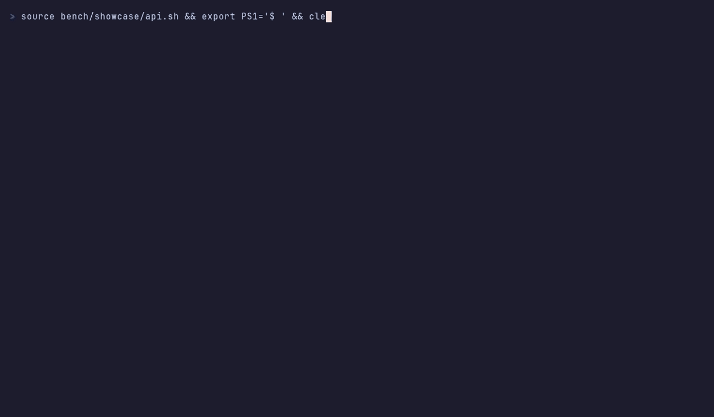
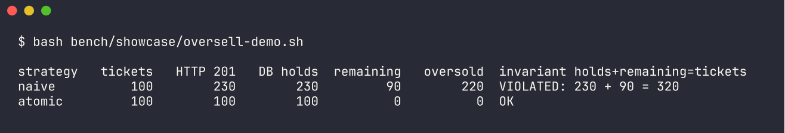
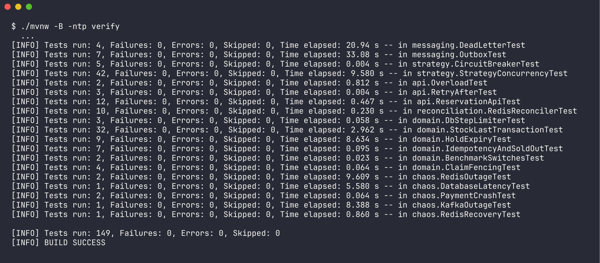
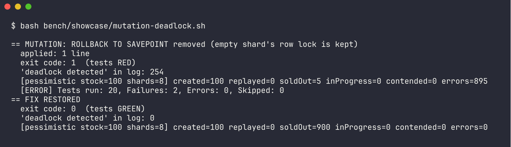
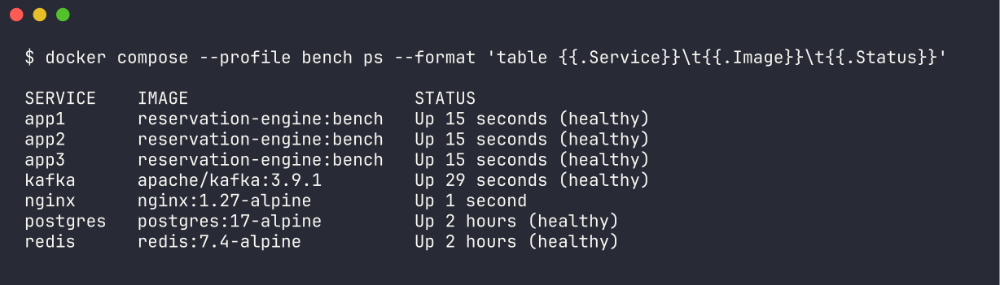
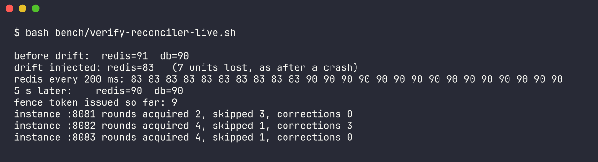
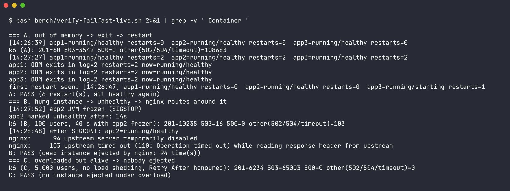
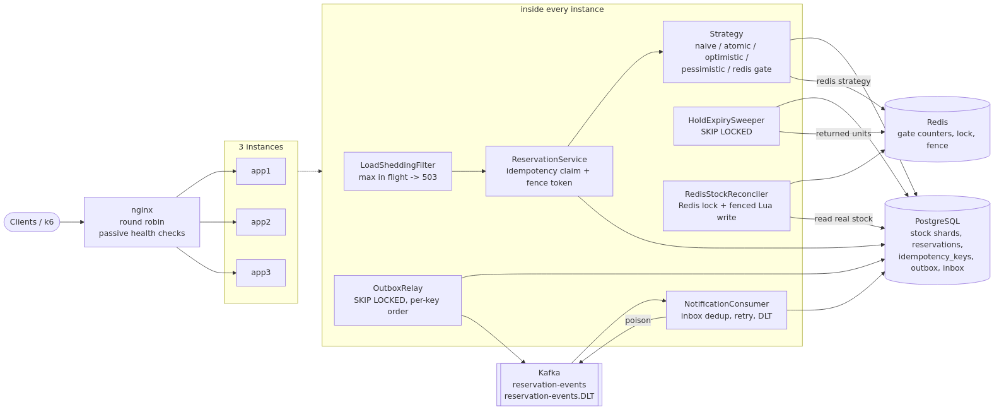

# Görseller

Bu klasördeki her görsel gerçek bir koşudan üretildi; hiçbir çıktı elle düzenlenmedi.

- **Komut:** Her terminal görselinin ilk satırı, çıktıyı üreten komut.
- **Ham metin:** Ham çıktılar [`raw/`](raw) altında.
- **Yeniden üretmek için:** `bash bench/showcase/render.sh` (yaklaşık 12 dk).
- **Araçlar:** Terminal görselleri için [freeze](https://github.com/charmbracelet/freeze) (SVG, sonra
  `rsvg-convert` ile PNG), GIF için [vhs](https://github.com/charmbracelet/vhs), diyagram için mermaid-cli.

## API akışı

Tek biletlik bir etkinlik, nginx üzerinden gerçek `curl` çağrıları:
1. Alice rezervasyon yapıyor: `201`, ödeme için tutuluyor.
2. Aynı `Idempotency-Key` ile tekrar: `200` + `Idempotent-Replayed: true`, aynı rezervasyon numarası, ikinci
   birim yok.
3. Bob: `409 sold out`.
4. Ödeme onayı: `200 CONFIRMED`.
5. İkinci etkinlikte süresi dolmuş tutuma ödeme: `410 Gone`, birim stoğa döndü.

Bu kayıtta tutma süresi 15 sn. Son adımdaki 16 saniyelik `sleep` komutu kayıtta görünüyor; bekleme süresi
GIF'ten kesildi.

## Overselling'in kanıtı

100 bilet için 1.000 eşzamanlı istek: 3 instance, nginx, k6. Sonuç doğrudan PostgreSQL'den okundu.
- **`naive`:** "oku, sonra okuduğunu yaz". 230 rezervasyon yaptı ve stokta hâlâ 90 görünüyor; 220 birim
  fazla satıldı. Kayıp güncellemeler yüzünden hem fazla satıyor hem de satılanları stoktan düşemiyor.
- **`atomic`:** `UPDATE ... WHERE qty > 0`. Tam olarak 100 sattı, invariant sağlandı.

## Tam test paketi

`./mvnw verify` çıktısının özeti: 149 test, 0 hata (hata enjeksiyonu testleri dahil). Gerçek PostgreSQL, Redis
ve Kafka ile çalışıyor (Testcontainers, Toxiproxy).

## Mutasyon örneği: deadlock düzeltmesi kaldırılınca

Aşama 3'teki düzeltme: pessimistic strateji, boş bir shard'ın satır kilidini `ROLLBACK TO SAVEPOINT` ile
bırakıyor.
- **Bu satır kaldırılınca:** 8 shard'lı eşzamanlılık testi kırmızıya döndü. Logda 254 "deadlock detected"
  satırı ve 895 hatalı istek var.
- **Satır geri konunca:** Test yeşil, 0 deadlock.

Not: Aşama 3'teki ilk ölçümde bu sayı 174'tü. Deadlock sayısı zamanlamaya bağlı; görseldeki sayı bu koşuya ait.

## Çalışan sistem

3 uygulama instance'ı, nginx, PostgreSQL, Redis ve Kafka.

## Redis–DB mutabakatı, canlı

Redis sayacından 7 birim düşüldü (bir çökmeden kalan kayma gibi): 90 → 83. Örnekleme 200 ms'de bir yapıldı.
Kayma yaklaşık 2 saniye görünüyor, sonra mutabakat turu sayacı 90'a getiriyor. Turlar 3 instance arasında
Redis kilidiyle paylaşılıyor ("acquired / skipped").

Görselde istenmeden yakalanan bir şey daha var: Kayma eklenmeden önce Redis **91**, DB **90**. Bir mutabakat
turu, o sırada commit edilmemiş bir rezervasyonla yarıştı ve sayacı bir fazla bıraktı. Bu, README'de analiz
edilen "güvenli yön". Bir sonraki tur sayacı 90'a indirdi.

## Fail fast: OOM'da çık, donmuş instance'ı trafikten çıkar

- **A. Bellek yetersizliği:**
  - Kurulum: 128 MB heap, yük atma kapalı, 3.000 kullanıcı.
  - Instance'lar `OutOfMemoryError` aldı; JVM kapandı (`-XX:+ExitOnOutOfMemoryError`).
  - Docker konteynerleri yeniden başlattı: toplam 6 yeniden başlatma, sonunda üçü de sağlıklı.
  - Bu ayardan önce OOM, Tomcat'in Acceptor thread'ini öldürüyordu: süreç yaşıyor, Docker "healthy" diyor,
    ama hiçbir istek cevaplanmıyordu.
- **B. Donmuş JVM:**
  - app2'ye `SIGSTOP` gönderildi. Healthcheck onu 14 sn içinde "unhealthy" yaptı.
  - nginx ilk zaman aşımından sonra ona trafik göndermeyi bıraktı.
  - 100 istemcili 40 saniyelik koşuda 10.235 başarılı isteğe karşı 103 zaman aşımı oldu. Bu, pasif sağlık
    kontrolünün bedeli: zaman aşımı penceresinde her istemcinin bir isteği takılıyor.
- **C. Aşırı yük, sağlıklı instance'lar:** 5.000 kullanıcı, yük atma kapalı. Hiçbir instance trafikten
  çıkarılmadı; 0 tane 502/504 (Aşama 7a'daki nginx düzeltmesi).

Bu görselin ham çıktısı `render.sh` tarafından doğrudan `... 2>&1 | grep -v ' Container '` ile üretildi; elle
filtreleme yok.

## Mimari

Kaynak: [`docs/architecture.mmd`](../architecture.mmd).

## Benchmark grafikleri

Ölçüm sonuçları [`docs/benchmarks/`](../benchmarks) altında:

| Grafik | Ne gösteriyor |
|---|---|
| [contention-throughput](../benchmarks/contention-throughput.png) | Tek sıcak satırda stratejilerin throughput'u (10–5.000 kullanıcı) |
| [contention-p99](../benchmarks/contention-p99.png) | Aynı ölçümde p99 gecikme |
| [contention-failures](../benchmarks/contention-failures.png) | Aşırı yükte başarısız isteklerin oranı |
| [sellout-throughput](../benchmarks/sellout-throughput.png) | Flaş satışta "tükendi" cevabının maliyeti |
| [optimistic-retries](../benchmarks/optimistic-retries.png) | Optimistic locking'de tekrar deneme sayısı |
| [sharding-contention](../benchmarks/sharding/sharding-contention.png) | Stok sharding'in çekişmedeki etkisi |
| [sharding-lock-wait](../benchmarks/sharding/sharding-lock-wait.png) | Shard sayısına göre kilit bekleme oranı |
| [sharding-sellout](../benchmarks/sharding/sharding-sellout.png) | Sharding'in flaş satıştaki bedeli |
| [sellout-before-after](../benchmarks/sellout-5b/sellout-before-after.png) | "Tükendi" kısayollarından önce ve sonra |
| [overload](../benchmarks/overload/comparison.md) | 5.000 kullanıcıda önce / sonra (Aşama 7a) |
